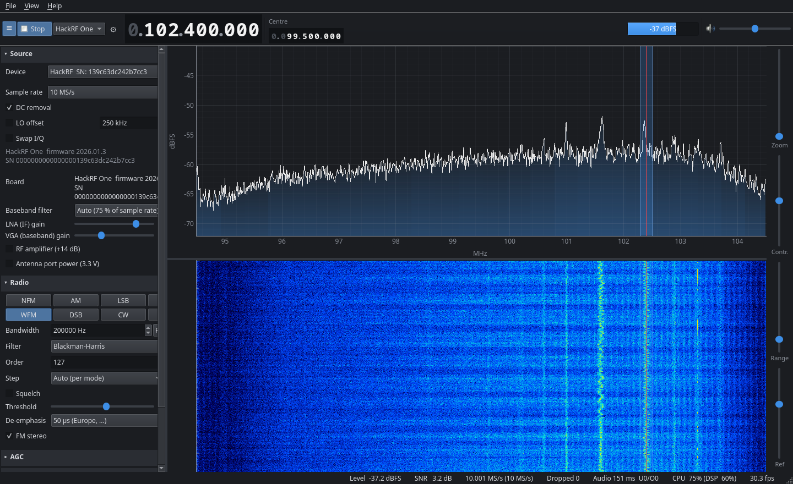
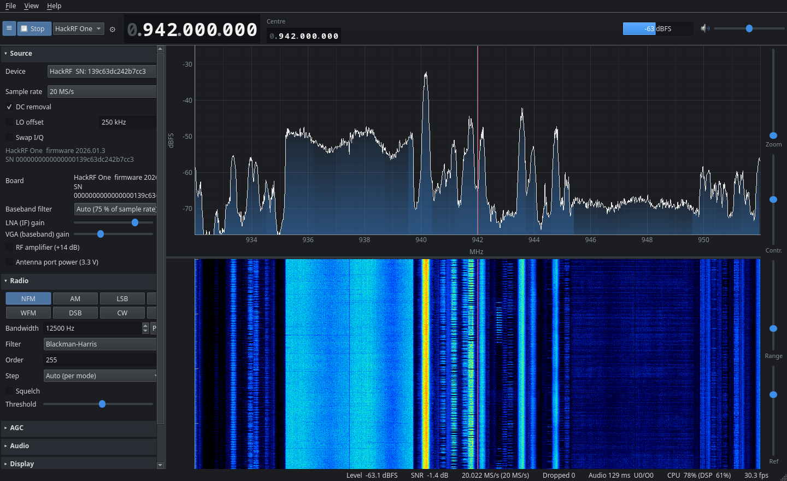
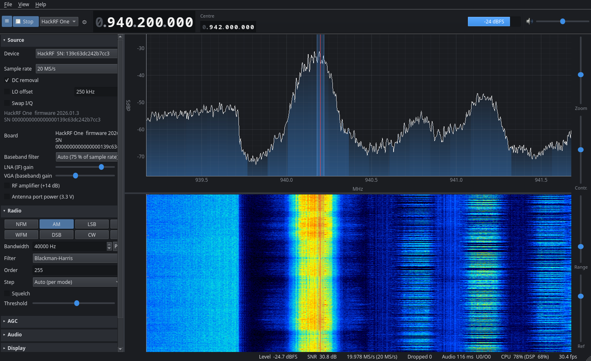

# PyRX

A receive-only software-defined radio for the desktop, written in Python (PyQt5, numpy/scipy,
pyqtgraph). The layout and workflow follow the classic SDR# style: a collapsible side panel,
a large frequency display, a spectrum above a waterfall, and a VFO you tune by clicking or dragging.

Sources: **simulated** receiver, **IQ file** playback, **RTL-SDR** (RTL2832U + R820T/R828D and
others), **HackRF One**. Receive only. There is no transmit code (the HackRF binding does not
even load libhackrf's TX functions).

Demodulators: WFM (mono/stereo, 50/75 µs de-emphasis), NFM, AM, USB, LSB, CW, DSB, RAW (I/Q to
the left/right audio channels). There is also AGC, squelch, baseband IQ and audio recording, a frequency
manager (bookmarks), and persisted settings.

### Screenshots

All three were captured live from a HackRF One.


*FM broadcast band (94.5–104.5 MHz) at 10 MS/s, tuned to a station at 102.4 MHz in WFM.*


*900 MHz mobile downlink at 20 MS/s: narrow GSM carriers next to a wideband 3G/LTE block.*


*The same capture zoomed 8×, with the VFO and AM passband on the carrier at 940.2 MHz.*

---

## 1. Install

PyRX needs Python 3.10 or newer.

```bash
python3 -m venv .venv
.venv/bin/pip install -r requirements.txt          # the app + simulated/file sources
.venv/bin/pip install -r requirements-hw.txt       # RTL-SDR binding (needs librtlsdr, see below)
.venv/bin/pip install -r requirements-dev.txt      # tests (pytest, pytest-qt)
```

`requirements.txt` installs from wheels and needs no system libraries. Everything that needs a
system library is optional at runtime:

| Feature | Needs | If missing |
|---|---|---|
| Sound | PortAudio (`libportaudio2`), bundled in the Windows/macOS wheels | PyRX runs with a silent null output and says so in the status bar |
| RTL-SDR | `librtlsdr` + `pyrtlsdr==0.3.0` | "RTL-SDR (unavailable)" in the source list, tooltip says why |
| HackRF One | `libhackrf` (no Python package needed) | "HackRF One (unavailable)" |

> **Why pyrtlsdr 0.3.0?** Versions 0.4.0 and later require `rtlsdr_set_dithering`, which the
> standard osmocom and RTL-SDR Blog libraries do not export, so `import rtlsdr` fails with those.

### Linux

Packages:

| Distribution | Command |
|---|---|
| Debian / Ubuntu | `sudo apt install python3-venv librtlsdr0 rtl-sdr libhackrf0 hackrf libportaudio2 libxcb-xinerama0 libxkbcommon-x11-0` |
| Fedora | `sudo dnf install rtl-sdr hackrf portaudio` |
| Arch | `sudo pacman -S rtl-sdr hackrf portaudio` (for an RTL-SDR Blog **V4** use `rtl-sdr-blog` from the AUR) |

The RTL-SDR Blog **V4** (R828D tuner) needs a librtlsdr that knows it: the RTL-SDR Blog build
(1.3.5 or newer) or osmocom 2.0.2 or newer. Older libraries tune it wrongly.

**udev rules** (so you don't need root). The `rtl-sdr` and `hackrf` packages usually install
these. If yours didn't, create `/etc/udev/rules.d/52-pyrx-sdr.rules`:

```
# RTL2832U dongles
SUBSYSTEM=="usb", ATTRS{idVendor}=="0bda", ATTRS{idProduct}=="2832", MODE="0660", TAG+="uaccess"
SUBSYSTEM=="usb", ATTRS{idVendor}=="0bda", ATTRS{idProduct}=="2838", MODE="0660", TAG+="uaccess"
# HackRF One (normal, and DFU mode)
SUBSYSTEM=="usb", ATTRS{idVendor}=="1d50", ATTRS{idProduct}=="6089", MODE="0660", TAG+="uaccess"
SUBSYSTEM=="usb", ATTRS{idVendor}=="1d50", ATTRS{idProduct}=="cc15", MODE="0660", TAG+="uaccess"
SUBSYSTEM=="usb", ATTRS{idVendor}=="1fc9", ATTRS{idProduct}=="000c", MODE="0660", TAG+="uaccess"
```

then `sudo udevadm control --reload-rules && sudo udevadm trigger` and re-plug the device.

**Blacklist the DVB-T driver** (otherwise the kernel claims the RTL dongle as a TV tuner and
PyRX reports "busy"). Create `/etc/modprobe.d/blacklist-rtl-sdr.conf`:

```
blacklist dvb_usb_rtl28xxu
blacklist rtl2832
blacklist rtl2830
blacklist rtl2832_sdr
```

then `sudo modprobe -r dvb_usb_rtl28xxu rtl2832_sdr rtl2832` (or reboot).

Check the hardware outside PyRX with `rtl_test` and `hackrf_info`.

### Windows

1. Install Python 3.10+ from python.org, then in the project folder:
   `py -m venv .venv` and `.venv\Scripts\pip install -r requirements.txt -r requirements-hw.txt`.
   Sound works out of the box (the sounddevice wheel bundles PortAudio).
2. **USB driver (Zadig).** Plug in the device, run [Zadig](https://zadig.akeo.ie), choose
   *Options → List All Devices*, then:
   * RTL-SDR: select **"Bulk-In, Interface (Interface 0)"** (sometimes "RTL2838UHIDIR"), choose
     **WinUSB**, *Replace Driver*.
   * HackRF One: select **"HackRF One"**, choose **WinUSB**, *Replace Driver*.
3. **Driver DLLs** (64-bit, matching your Python):
   * RTL-SDR: `rtlsdr.dll` and `libusb-1.0.dll` from the
     [RTL-SDR Blog release](https://github.com/rtlsdrblog/rtl-sdr-blog/releases) (`Release.zip`, x64 folder).
     Older osmocom builds also need `pthreadVC2.dll` (and `msvcr100.dll`).
   * HackRF: `hackrf.dll` and `libusb-1.0.dll` (plus `pthreadVC2.dll` for older builds), from a
     HackRF Windows build, PothosSDR (`C:\Program Files\PothosSDR\bin`) or radioconda.
   * Put them in the project's **`drivers\`** folder, or in a folder named by the
     `PYRX_DLL_DIR` environment variable. Folders on `PATH` that contain `rtlsdr.dll` / `hackrf.dll`
     are also used. (Python 3.8+ no longer searches `PATH` for ctypes DLLs, so PyRX registers these
     folders itself.)

---

## 2. Run

```bash
.venv/bin/python -m pyrx                      # last used source and settings
.venv/bin/python -m pyrx --source simulated --autostart
.venv/bin/python -m pyrx --file capture_100MHz_2.4Msps.cu8 --autostart
```

Running the file directly (`.venv/bin/python pyrx/__main__.py`, e.g. as an IDE run
configuration) works as well.

Options: `--source {simulated,file,rtlsdr,hackrf}`, `--file PATH`, `--freq HZ`, `--mode MODE`,
`--autostart`, `--exit-after SECONDS`, `--no-audio` (null output; `PYRX_NO_AUDIO=1` does the same),
`--config-dir DIR`, `--reset-settings`, `--stats` (log fps/CPU/drops every second),
`--log-level`.

Headless check (used by the test suite):

```bash
QT_QPA_PLATFORM=offscreen .venv/bin/python -m pyrx --source simulated --autostart --exit-after 10
```

Settings and bookmarks are in `~/.config/pyrx/` (Linux), `%APPDATA%\PyRX\` (Windows),
`~/Library/Application Support/PyRX/` (macOS).

## 3. Using it

* **Top bar:** ☰ side panel · Start/Stop · source · ⚙ device settings · VFO frequency · centre
  frequency · signal level · mute · volume.
* **Frequency display:** hover a digit and use the mouse wheel; click the upper or lower half of a
  digit to step it up or down; or click it and type digits (Left/Right moves the cursor, Up/Down
  steps). Enter or Ctrl+F opens a box that accepts `145.5M`, `7074k`, `100000000`, and so on.
* **Spectrum / waterfall:** click to tune. Drag inside the shaded passband to move the VFO, or
  drag its edges to change the bandwidth. The mouse wheel tunes by the step; Ctrl+wheel zooms
  around the mouse. Right- or middle-drag pans a zoomed view. The splitter between spectrum and
  waterfall is draggable. The right-hand sliders set zoom, waterfall contrast, dB range and
  reference level; *Display → Auto levels* (or `A`) fits them to the signal.
* **Tuning policy:** the VFO is independent of the hardware centre frequency. When the passband
  would leave the usable span, the centre frequency follows. With **LO offset** (Source panel),
  the hardware is tuned below the VFO, so the VFO never sits on the DC spike.
* **Status bar:** level and SNR at the VFO · measured sample rate · dropped blocks · audio
  buffer and underruns/overruns · CPU (% of one core, DSP thread in brackets) · display fps.

Keyboard: `Space` start/stop · `←/→` step tune (`Shift` = ×10) · `↑/↓` volume · `M` mute ·
`S` squelch · `A` auto levels · `Alt+1…8` modes · `Ctrl+F` enter frequency · `Ctrl+B` bookmark ·
`Ctrl+R` record audio · `Ctrl+Shift+R` record IQ · `Ctrl +/-` zoom · `Ctrl+L` side panel ·
`F11` full screen (also in *Help → Keyboard shortcuts*).

**Simulated source:** fixed signals around 100 MHz (WFM stereo at 99.8, NFM voice bursts at
100.25, CW beacon at 100.45, AM voice at 100.6, USB voice at 100.75). Frequencies, levels,
noise and an optional DC spike can be changed in ⚙.

**Recordings** go to the folder in the Recording panel. IQ recordings are WAV files, with the
centre frequency and sample rate in the name (`pyrx_<UTC time>_<centre>Hz_<rate>sps_IQ.wav`),
so they replay directly in the IQ file source. Files are split before 4 GB.

## 4. Tests

```bash
.venv/bin/python -m pytest
```

No hardware and no sound card are needed. The suite includes the acceptance tests (NFM/AM/SSB/WFM
demodulation, block continuity, spectrum bin mapping, decimation, file round trip, headless
smoke run) plus unit and GUI tests.

## 5. Manual hardware test checklist

Tick each item and note anything odd. "OK" means: no traceback, no hang, sensible audio.

**General (any device)**
- [ ] Device appears in the Source panel device list (index + serial); ⟳ rescans after re-plugging.
- [ ] Start/Stop with the button and with `Space`, ten times in a row. Each stop is immediate and the device can be restarted.
- [ ] Status bar shows the measured rate ≈ the nominal rate, and `Dropped 0` after a minute.
- [ ] Changing the sample rate while running restarts cleanly, and the spectrum span changes.

**WFM broadcast FM (RTL-SDR, then HackRF)**
- [ ] Tune a strong local FM station (type it into the frequency display). Mode WFM, 200 kHz.
- [ ] Clean audio without clicks; STEREO lights on a stereo station and music is audibly stereo on headphones.
- [ ] De-emphasis: 50 µs (Europe) / 75 µs (Americas) changes the treble as expected.
- [ ] Clicking another station in the spectrum retunes; dragging the passband tunes smoothly.
- [ ] Toggle DC removal: the spike at the centre disappears/reappears. Enable LO offset and click near the centre: the hardware retunes so the VFO is off-centre.

**NFM on a local repeater / PMR446**
- [ ] Mode NFM, 12.5 kHz (PMR446: 446.00625 MHz + n × 12.5 kHz). Speech is intelligible.
- [ ] Squelch: enable it and set the threshold just above the noise level (the `dBFS` reading next to "Squelch"). Audio is silent between transmissions and opens without a click.
- [ ] Bookmark it (`Ctrl+B`), tune away, then double-click the bookmark: frequency, mode and bandwidth come back.

**AM airband (118–137 MHz)**
- [ ] Mode AM, 8.33 kHz or 10 kHz bandwidth. Tune an ATIS/tower frequency.
- [ ] AGC on: weak and strong transmissions come out at similar loudness. AGC off plus manual gain also works.

**RTL-SDR specifics**
- [ ] Gain slider lists the tuner's real gains. Tuner AGC on disables the slider. RTL AGC toggles.
- [ ] Frequency correction (ppm) shifts a known carrier by the expected amount.
- [ ] Direct sampling Q-branch (V3) receives HF (e.g. a 9.4–9.9 MHz broadcast in AM). On a V4, HF works in normal mode instead.
- [ ] Offset tuning on R820T/R828D shows "not supported" (expected). Bias-T asks for confirmation before switching on.

**HackRF One at 10 MS/s**
- [ ] Select HackRF, sample rate 10 MS/s, FFT 8192, WFM on a broadcast station.
- [ ] Watch the status bar for one minute: `Dropped` stays 0 (or only grows at start-up), measured rate ≈ 10.000 MS/s, display ≥ 25 fps, audio has no gaps. Note the CPU %. Repeat at 16 and 20 MS/s and note the highest rate that still has 0 drops.
- [ ] LNA 0–40 dB (8 dB steps) and VGA 0–62 dB (2 dB steps) change the noise floor. RF amp toggles (+14 dB).
- [ ] Baseband filter Auto vs. a manual value changes the visible roll-off at the span edges.
- [ ] Antenna port power asks for confirmation. Answering *Cancel* leaves it off. It is never on after a restart.

**Unplugging a device mid-stream (each device)**
- [ ] While streaming, pull the USB cable. Within ~3 s exactly **one** error dialog appears ("…stopped streaming / may have been unplugged"), the Start button returns to *Start*, and the UI stays responsive (no hang, no repeated dialogs, no traceback).
- [ ] Re-plug, press ⟳ in the Source panel, press Start: streaming resumes.

**Recording / playback**
- [ ] Record 20 s of baseband IQ and 20 s of audio. Elapsed time and file size count up.
- [ ] Open the IQ file (*File → Open IQ file…*): centre frequency and rate are taken from the name, and the same signals appear at the same frequencies. Loop and the position slider work.
