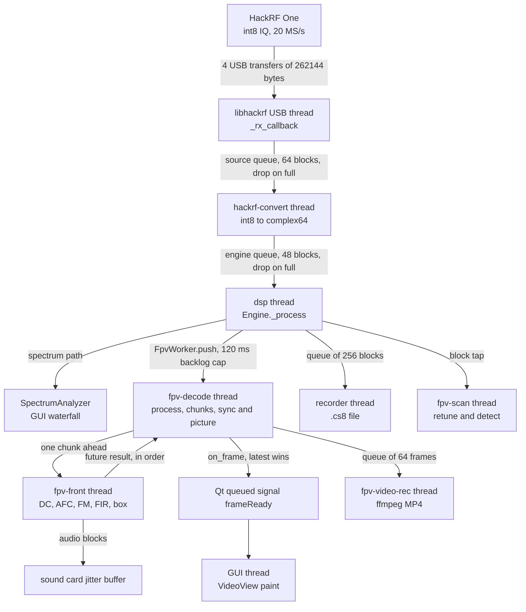
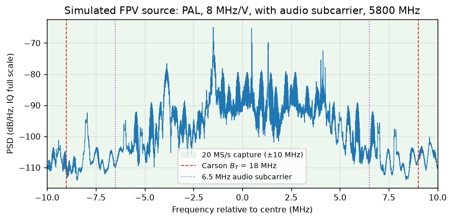
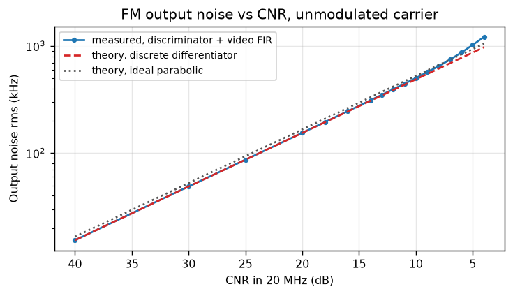
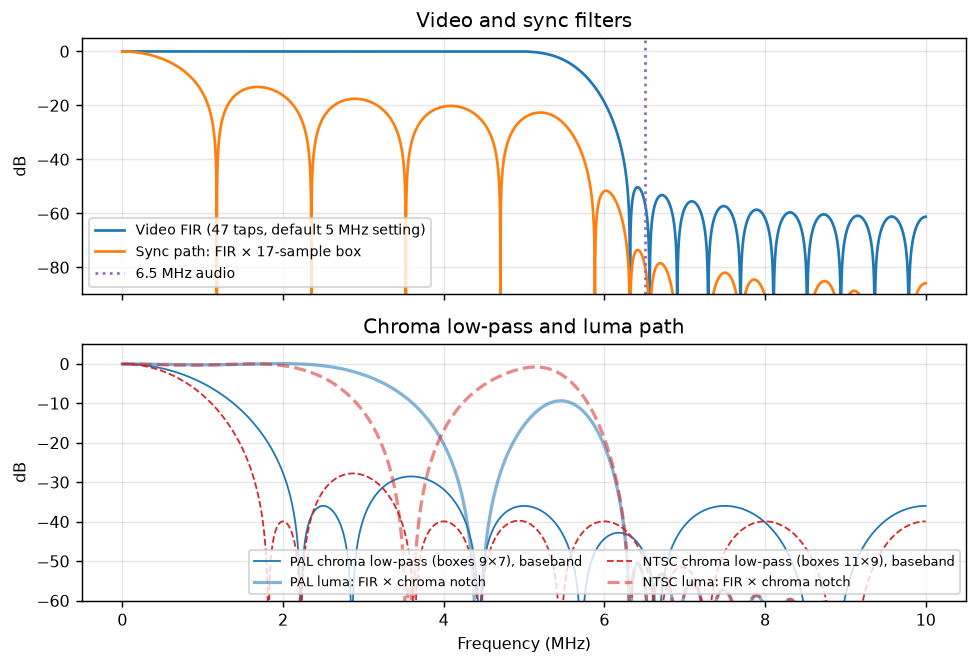
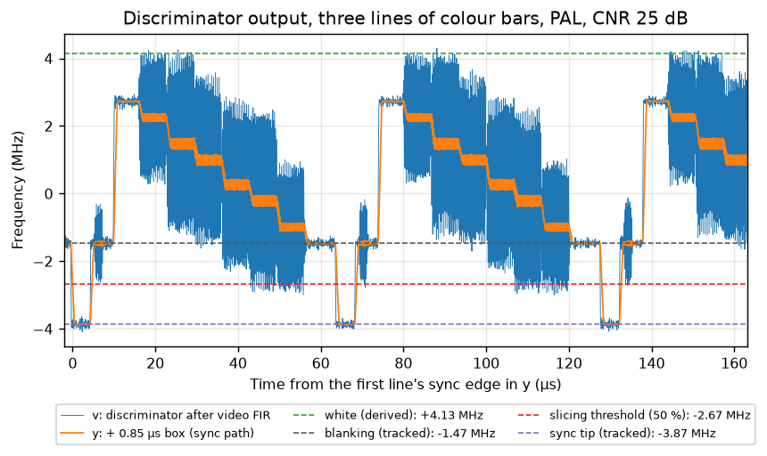
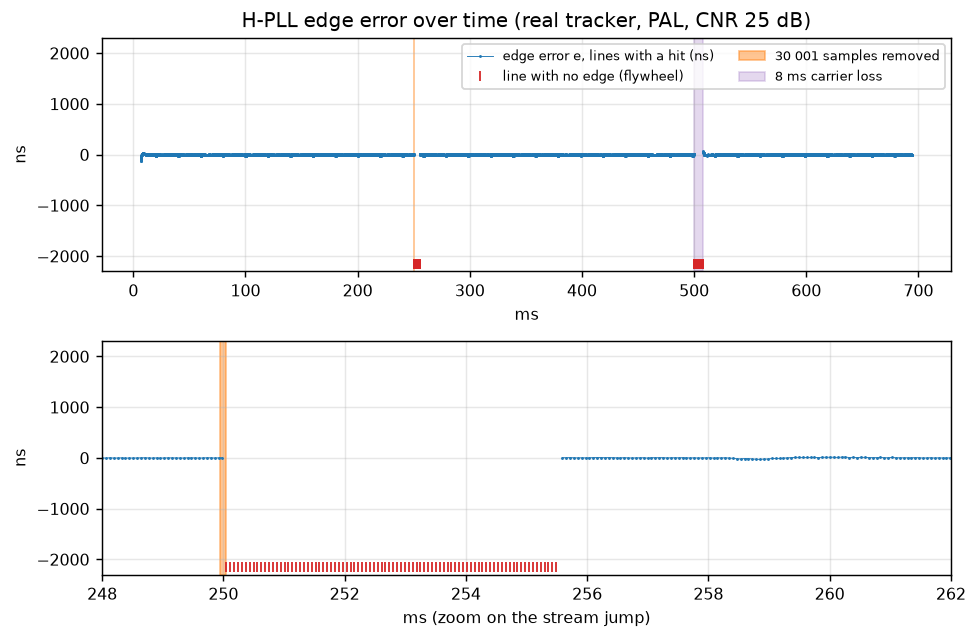
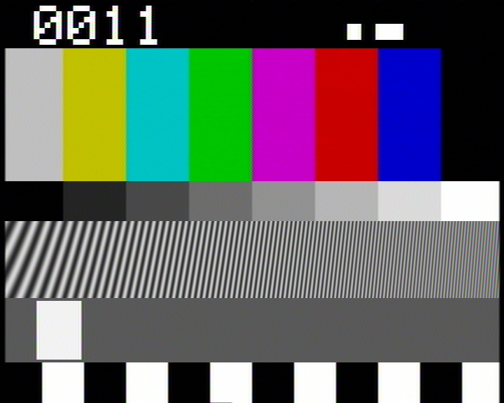
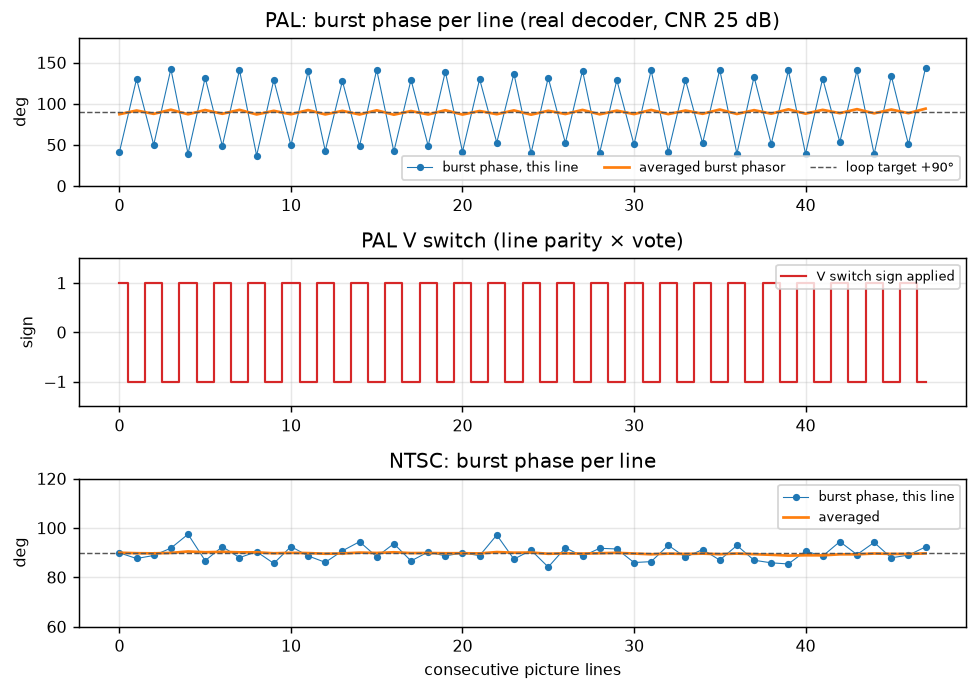

# FPV video reception: technical description

How SpecSDR receives analog FPV drone video, from the HackRF driver call to the pixels on screen. This describes the code on branch `fpv-video`.

**Reading the numbers.** Every numeric property here was computed by running the project's own code in its venv at 20 MS/s, unless it is marked *live* (a real HackRF One r9 receiving a real RunCam camera and analog VTX on 5843 MHz on 2026-11-09) or *reference* (a published standard). [Appendix A](#appendix-a-how-the-numbers-were-obtained) says how each group was measured. CNR always means carrier power divided by noise power across the whole 20 MHz capture.

**Contents:** [1 Overview](#1-overview) · [2 Signal background](#2-signal-background) · [3 Receiving](#3-receiving) · [4 FM demodulation](#4-fm-demodulation) · [5 Video filtering](#5-video-filtering) · [6 Sync](#6-sync) · [7 Line and frame reconstruction](#7-line-and-frame-reconstruction) · [8 Colour](#8-colour) · [9 Audio subcarrier](#9-audio-subcarrier) · [10 Scanner](#10-scanner) · [11 Recording and playback](#11-recording-and-playback) · [12 Display and threading](#12-display-and-threading) · [13 Performance](#13-performance) · [14 Parameter reference](#14-parameter-reference) · [15 Tests](#15-tests) · [16 Findings](#16-findings)

---

## 1. Overview

Analog FPV video is composite video frequency-modulated onto a 5.8 GHz carrier. SpecSDR captures ±10 MHz around the carrier, undoes the FM with a software discriminator, recovers line and field timing from the sync pulses, and rebuilds colour frames.



| Stage | File and function | Rate | Data at the output |
|---|---|---|---|
| USB capture | [`_rx_callback`](../specsdr/sources/hackrf_source.py#L183-L193) | 20 MS/s | `bytes`, interleaved int8, 262144 bytes |
| Scaling | [`HackRFSource._run`](../specsdr/sources/hackrf_source.py#L228-L246) | 20 MS/s | complex64, ±1.0 full scale, 131072 samples |
| Routing | [`Engine._process`](../specsdr/core/engine.py#L463-L513) | 20 MS/s | same array, plus arrival time |
| Load shedding | [`FpvWorker.push`](../specsdr/core/fpv.py#L58-L73) | 20 MS/s | deque of blocks and gap markers |
| Chunking | [`FpvDecoder.process`](../specsdr/dsp/fpv/decoder.py#L207-L228) | 20 MS/s | complex64, fixed 131072 samples |
| DC removal | [`DcRemover.process`](../specsdr/dsp/dc.py#L25-L41) | 20 MS/s | complex64 |
| AFC mixer | [`Mixer.process`](../specsdr/dsp/nco.py#L42-L50) | 20 MS/s | complex64 |
| Discriminator | [`_front`](../specsdr/dsp/fpv/decoder.py#L315-L339) | 20 MS/s | float32, Hz |
| Video FIR | [`fir_filter`](../specsdr/dsp/fpv/kernels.py#L34-L49) | 20 MS/s | float32 `v`, Hz |
| Sync box | [`_front`](../specsdr/dsp/fpv/decoder.py#L315-L339) | 20 MS/s | float32 `y`, Hz |
| Acquisition | [`_acquire`](../specsdr/dsp/fpv/decoder.py#L396-L428) | per chunk | pulse times, float64 samples |
| Line tracking | [`track_lines`](../specsdr/dsp/fpv/kernels.py#L111-L182) | line rate | line start times, hit flags, levels |
| Vertical sync | [`find_vsync`](../specsdr/dsp/fpv/kernels.py#L186-L206) | line rate | half-line index of field start |
| Pixels and colour | [`decode_lines`](../specsdr/dsp/fpv/kernels.py#L305-L442) | line rate | float32 Y, U, V rows of 720 |
| Field assembly | [`_finish_field`](../specsdr/dsp/fpv/decoder.py#L755-L787) | field rate | planes 720 × 288 or 240 |
| RGB | [`render_rgb`](../specsdr/dsp/fpv/kernels.py#L446-L464) | frame rate | uint8 720 × 576 or 480 × 3 |
| Display | [`VideoView.paintEvent`](../specsdr/ui/fpv.py#L74-L105) | up to frame rate | scaled to the widget |

Entering FPV mode goes through [`_enter_fpv`](../specsdr/ui/main_window.py#L1194-L1233), which sets 20 MS/s and a 20 MHz baseband filter. [`_fpv_reconfigure`](../specsdr/ui/main_window.py#L1273-L1283) then creates the worker.

The decoder works on a fixed grid of chunks anchored to the sample stream. Any way of cutting the input into blocks gives identical frames, and a test checks this ([`test_block_continuity_identical_frames`](../tests/test_fpv_acceptance.py#L175-L192)).

---

## 2. Signal background

### 2.1 Composite video as FM

A camera produces composite video $c(t)$ in volts. The transmitter frequency-modulates a carrier $f_c$ with it. At complex baseband the signal is

$$
s(t) = A \exp\left( j 2\pi \int_0^t f_i(\tau)\, d\tau \right),
\qquad
f_i(t) = K_f \left( c(t) - \bar{c} \right) + \Delta f
$$

where $A$ is the amplitude, $f_i$ the instantaneous frequency relative to the tuned centre, $K_f$ the modulator sensitivity in Hz/V, $\bar{c}$ the average picture level removed by AC coupling in the transmitter, and $\Delta f$ the carrier error.

Because of the AC coupling, blanking does not sit at a fixed frequency: it moves with picture brightness. The decoder therefore never assumes an absolute frequency for any video level and measures levels from the sync pulses instead.

The simulator implements this in [`FpvTransmitter.generate`](../specsdr/dsp/fpv/pattern.py#L396-L411), with $K_f$ = 8 MHz/V by default.

*Live:* the real VTX had a sync height of 1.82 MHz on NTSC, which gives $K_f \approx$ 6.4 MHz/V.

### 2.2 PAL and NTSC parameters

Reference values are from ITU-R BT.470 and BT.1700 (PAL B/G) and SMPTE 170M (NTSC-M). Code values are in [`PAL`](../specsdr/dsp/fpv/standards.py#L67-L71) and [`NTSC`](../specsdr/dsp/fpv/standards.py#L73-L78).

| Parameter | PAL reference | PAL code | NTSC reference | NTSC code |
|---|---|---|---|---|
| Lines per frame | 625 | 625 | 525 | 525 |
| Field rate (Hz) | 50 | 50 | 59.94 | 60000/1001 |
| Line rate (Hz) | 15625 | 15625 | 15734.27 | 4.5 MHz/286 |
| Line period (µs) | 64 | 64 | 63.556 | 63.556 |
| Subcarrier (Hz) | 4433618.75 | 4433618.75 | 3579545.45 | 315 MHz/88 |
| Subcarrier cycles per line | 283.7516 | 283.7516 | 227.5 | 227.5 |
| Line sync width (µs) | 4.7 | 4.7 | 4.7 | 4.7 |
| Equalising pulse (µs) | 2.35 | 2.35 | 2.3 | 2.3 |
| Burst start after 0H (µs) | 5.6 | 5.6 | 5.3 | 5.3 |
| Burst length (cycles) | 10 | 10 | 9 | 9 |
| Active start after 0H (µs) | 10.4 | 10.5 | 9.4 | 9.4 |
| Active width (µs) | 52 | 52 | 52.66 | 52.656 |
| Active lines per field | 287.5 | 288 | 242.5 | 240 |
| Sync tip (V) | −0.3 | −0.3 | −0.286 | −40/140 |
| Black above blanking (V) | 0 | 0 | 0.054 | 7.5/140 |
| Peak white (V) | 0.7 | 0.7 | 0.714 | 100/140 |
| Burst amplitude, peak (V) | 0.15 | 0.15 | 0.143 | 20/140 |
| Burst phase | ±135° | ±135° | 180° | 180° |

The small differences (PAL active start, active line counts) are listed in [Findings](#16-findings).

### 2.3 Bandwidth

Carson's rule estimates the occupied bandwidth of FM:

$$
B_T \approx 2 \left( \Delta f_{\mathrm{pk}} + f_m \right)
$$

with $\Delta f_{\mathrm{pk}}$ the peak deviation from the carrier and $f_m$ the highest modulating frequency. In the simulator the instantaneous frequency spans −3.87 to +4.13 MHz (PAL, 8 MHz peak to peak), so $\Delta f_{\mathrm{pk}} \approx$ 4 MHz. With $f_m$ = 5 MHz this gives $B_T \approx$ 18 MHz, which fits inside the 20 MS/s capture and matches [`FPV_BW`](../specsdr/config/fpv_channels.py#L18).

| Measured on the simulated transmitter | 99 % power bandwidth | 99.9 % power range |
|---|---|---|
| PAL, video only | 10.29 MHz | −6.32 to +6.75 MHz |
| PAL with 6.5 MHz audio subcarrier | 11.50 MHz | −9.25 to +9.55 MHz |
| NTSC, video only | 9.34 MHz | −5.73 to +7.05 MHz |

Carson's rule overstates the energy-bearing bandwidth for video because full white and full sync are rare. The audio subcarrier is what pushes the skirts close to the capture edges.



### 2.4 FM output noise

Take a carrier of power $C = A^2$ plus complex white noise $n(t)$ with total two-sided density $N_0$, so noise power in the capture is $N_0 f_s$. In a frame rotating with the carrier, $n = n_I + j n_Q$, and each component has density $N_0/2$. For a strong carrier the phase perturbation is

$$
\phi_n(t) = \arg\left( A + n_I + j n_Q \right) \approx \frac{n_Q(t)}{A}
$$

so $S_\phi(f) = N_0 / (2C)$. Frequency is the derivative of phase divided by $2\pi$, so multiply the density by $f^2$:

$$
S_{f}(f) = \frac{f^2 N_0}{2 C}
$$

This is the parabolic noise spectrum of FM. Through a video filter $H(f)$ the output noise variance is

$$
\sigma_v^2 = \frac{N_0}{2C} \int_{-f_s/2}^{f_s/2} f^2 \lvert H(f) \rvert^2 \, df
$$

For an ideal low-pass of width $B$ and with $\rho = C / (N_0 f_s)$ the capture-band CNR, the integral is $2B^3/3$:

$$
\sigma_v^2 = \frac{B^3}{3 \rho f_s}
$$

The code differentiates by a one-sample phase difference, not a true derivative, so the exact form replaces $f^2$ by $(f_s/2\pi)^2 \lvert 1 - e^{-j 2\pi f / f_s} \rvert^2$.

The video SNR is the black-to-white swing $S_{pp}$ over the noise rms:

$$
\mathrm{SNR}_v = \frac{S_{pp}^2}{\sigma_v^2} = 3 \rho \, \frac{f_s S_{pp}^2}{B^3}
$$

With $S_{pp}$ = 5.6 MHz (0.7 V at 8 MHz/V) and the measured effective parabolic bandwidth of the real FIR, $B$ = 5.50 MHz, the ideal form gives $\mathrm{SNR}_v = \mathrm{CNR} + 10.5$ dB. The discrete differentiator gives $\mathrm{CNR} + 11.2$ dB, and that is what the code measures:

| CNR (dB) | Measured rms (kHz) | Theory, discrete (kHz) | Excess (dB) | Video SNR (dB) |
|---|---|---|---|---|
| 40 | 15.4 | 15.4 | −0.01 | 51.2 |
| 30 | 48.9 | 48.8 | 0.01 | 41.2 |
| 25 | 86.8 | 86.8 | 0.00 | 36.2 |
| 20 | 154.7 | 154.4 | 0.02 | 31.2 |
| 14 | 311.4 | 308.0 | 0.10 | 25.1 |
| 12 | 394.4 | 387.7 | 0.15 | 23.0 |
| 10 | 502.3 | 488.1 | 0.25 | 20.9 |
| 8 | 647.2 | 614.5 | 0.45 | 18.7 |
| 6 | 867.1 | 773.6 | 0.99 | 16.2 |
| 5 | 1023.0 | 868.0 | 1.43 | 14.8 |
| 4 | 1213.9 | 973.9 | 1.91 | 13.3 |

A real transmitter at 6.4 MHz/V is about 2 dB worse than this table for the same CNR, since $S_{pp}$ scales with $K_f$.



### 2.5 Threshold and click noise

The small-noise step above fails when $\lvert n \rvert$ can exceed $A$. The received phasor can then circle the origin, and the phase jumps by $\pm 2\pi$. The discriminator emits a narrow spike whose time integral is one cycle: a click. Classical analysis (Rice) gives a click rate of the order of $B\,\mathrm{erfc}(\sqrt{\rho_B})$ per second, where $\rho_B$ is the CNR in the noise bandwidth $B$. This rises steeply as $\rho_B$ falls toward about 10 dB.

Clicks have a flat spectrum, so the video filter passes only a fraction of their energy. The excess column above is the visible effect. It reaches 1 dB at a capture-band CNR of 6 dB. In the picture it appears as bright or dark comets. **The decoder has no click suppression**, so all of it reaches the picture.

Picture quality against CNR on the simulated signal, with no frame drops down to 5 dB:

| CNR (dB) | PAL PSNR (dB) | PAL lost lines | NTSC PSNR (dB) | NTSC lost lines |
|---|---|---|---|---|
| 25 | 31.5 | 0 % | 33.1 | 0 % |
| 20 | 30.8 | 0 % | 31.5 | 0 % |
| 15 | 29.3 | 0 % | 28.6 | 0 % |
| 12 | 27.7 | 0 % | 26.2 | 0 % |
| 10 | 26.4 | 0 % | 24.4 | 0 % |
| 8 | 24.5 | 0 % | 22.4 | 0.01 % |
| 6 | 20.3 | 0.03 % | 18.4 | 0.11 % |
| 5 | 18.2 | 0.23 % | 16.4 | 0.41 % |
| 4 | 4.4 (re-acquired) | 3.39 % | 14.9 | 0.82 % |
| 3 | 14.1 | 1.62 % | no lock | n/a |

Below about 5 dB, sync starts failing before the picture is unusable.

---

## 3. Receiving

**What and why.** Configure the HackRF, move 40 MB/s of samples from USB to the decoder without blocking the USB thread, and detect lost data.

**Input and output.** Input is RF. Output is complex64 blocks of 131072 samples, ±1.0 full scale, at 20 MS/s, one block per 6.55 ms.

### 3.1 Configuration

| Setting | Code | Reference (HackRF One) | Status |
|---|---|---|---|
| Sample rate | [`RATES`](../specsdr/sources/hackrf_source.py#L18), any value in 2–20 MS/s via [`sample_rate_range`](../specsdr/sources/hackrf_source.py#L161-L162) | 2–20 MS/s, 8-bit I/Q | matches |
| Baseband filters | [`BB_FILTERS`](../specsdr/sources/hackrf_source.py#L19), 16 values | 1.75 to 28 MHz, same 16 values | matches |
| Filter applied | [`_bb_filter_value`](../specsdr/sources/hackrf_source.py#L85-L90) through `hackrf_compute_baseband_filter_bw` | | returns each listed value exactly |
| RF amplifier | [`controls`](../specsdr/sources/hackrf_source.py#L58-L74), on or off | 0 or about 11 dB | tooltip says +14 dB, see Findings |
| LNA | 0–40 dB, rounded to 8 dB in [`_apply_control`](../specsdr/sources/hackrf_source.py#L92-L109) | 0–40 dB in 8 dB steps | matches |
| VGA | 0–62 dB, rounded to 2 dB | 0–62 dB in 2 dB steps | matches |
| Antenna port power | bool with a confirmation, never restored, forced off in [`close`](../specsdr/sources/hackrf_source.py#L143-L153) | 50 mA max at 3.0–3.3 V | dialog omits the current limit |

Defaults are LNA 16, VGA 20, amp off. FPV mode forces the filter to [`FPV_BB_FILTER`](../specsdr/ui/main_window.py#L1174), 20 MHz, so that the whole FM signal passes. Outside FPV mode the "Auto" setting would choose 15 MHz at 20 MS/s (75 % of the rate).

*Live gain results, amp off, about bench distance:*

| LNA / VGA (dB) | CNR (dB) |
|---|---|
| 16 / 20 (default) | 13.7 |
| 24 / 30 | 21.8 |
| 32 / 30 | 22.3 |
| 40 / 30 | 15.8 (overload) |

**Tuning.** Raise LNA until CNR stops improving, then back off one step. Watch CNR in the overlay, not the level. The 8-bit ADC has little headroom, and at bench distance the front end overloads quickly.

### 3.2 Streaming

The binding is a thin ctypes layer, [`_declare`](../specsdr/sources/_hackrf_ctypes.py#L58-L86), which binds receive functions only, so SpecSDR cannot transmit. Three threads and two queues are involved:

1. libhackrf's USB thread calls [`_rx_callback`](../specsdr/sources/hackrf_source.py#L183-L193). It copies the buffer with `ctypes.string_at` and calls `put_nowait` on a 64-block queue ([`__init__`](../specsdr/sources/hackrf_source.py#L28-L40)). `libhackrf` itself reports 4 transfers of 262144 bytes, which is 131072 IQ samples, or 6.55 ms each.
2. The `hackrf-convert` thread, [`HackRFSource._run`](../specsdr/sources/hackrf_source.py#L228-L246), converts and calls the engine.
3. The engine's [`_on_block`](../specsdr/core/engine.py#L223-L230) stamps the arrival time and calls `put_nowait` on a queue of [`QUEUE_BLOCKS`](../specsdr/core/engine.py#L68) = 48. The `dsp` thread consumes it in [`_dsp_loop`](../specsdr/core/engine.py#L431-L452).

Queue capacity is 64 × 6.55 = 419 ms and 48 × 6.55 = 315 ms. In normal running both are nearly empty.

### 3.3 Conversion

$$
x[n] = \frac{\mathrm{int8}_I[n] + j\, \mathrm{int8}_Q[n]}{128}
$$

The bytes are reinterpreted, cast to float32 and scaled, then viewed as complex64 without copying. Full scale is −1.0 to +0.992.

### 3.4 Dropped samples

Losses are counted in three places, and only the last one reaches the decoder:

| Where | Counter | Decoder told? |
|---|---|---|
| Source queue full | [`overflows`](../specsdr/sources/hackrf_source.py#L183-L193) | no |
| Engine queue full | [`dropped_blocks`](../specsdr/core/engine.py#L223-L230) | no |
| Decoder backlog over 120 ms | [`FpvWorker.push`](../specsdr/core/fpv.py#L58-L73) | yes, by [`notify_gap`](../specsdr/dsp/fpv/decoder.py#L236-L255) |

The binding reads no loss counter from the device, so a loss inside USB or the firmware isn't seen at all. A silent loss in the first two places looks to the decoder like a jump in the stream, and the re-phase search of section 6.8 recovers it.

[`_run`](../specsdr/sources/hackrf_source.py#L228-L246) polls `hackrf_is_streaming` every 0.5 s to detect a disconnect. The engine's [`WATCHDOG_S`](../specsdr/core/engine.py#L70) reports 3 s without samples.

### 3.5 Retuning

[`_hw_set_center`](../specsdr/sources/hackrf_source.py#L167-L171) calls `hackrf_set_freq` and updates `_center`. Nothing is flushed. Samples already in USB transfers and queues keep flowing and are labelled with the new centre by the convert thread. The scanner compensates by discarding [`retune_settle_s`](../specsdr/sources/hackrf_source.py#L26) = 60 ms after each retune. The decoder isn't told about retunes at all: it loses sync and re-acquires.

In FPV mode the carrier must sit at the centre. [`_tune_ctx`](../specsdr/ui/main_window.py#L896-L904) reports an 18 MHz passband while the usable bandwidth is 16 MHz, so [`plan`](../specsdr/core/tuning.py#L32-L60) always finds the passband outside and recentres on the VFO. For a file source the centre cannot move, and the VFO has no effect on what is decoded.

### 3.6 DC spike

Direct-conversion receivers have a spike at 0 Hz from LO leakage, and in FPV mode the carrier sits right on it. [`DcRemover`](../specsdr/dsp/dc.py#L10-L41) tracks a block-wise average with time constant $\tau$ = 50 ms ([`_build`](../specsdr/dsp/fpv/decoder.py#L116-L179)) and subtracts it with a linear ramp across the block.

For block means $M_m$ of $N$ samples, the estimate is

$$
D_m = D_{m-1} + k \left( M_m - D_{m-1} \right),
\qquad
k = 1 - e^{-N / (f_s \tau)}
$$

Treating the block as one step of a discrete system, the output transfer function is

$$
H(z) = 1 - \frac{k}{1 - (1-k) z^{-1}} = \frac{(1-k)\left(1 - z^{-1}\right)}{1 - (1-k) z^{-1}}
$$

which has a zero at DC and a pole at $1-k$. With $N$ = 131072, $k$ = 0.1228 and the corner is $1/(2\pi\tau)$ = 3.18 Hz.

| Tone (Hz) | 0.5 | 1 | 2 | 3.18 | 5 | 10 | 20 | 50 |
|---|---|---|---|---|---|---|---|---|
| Gain (dB) | −16.2 | −10.5 | −5.5 | −3.0 | −1.5 | −0.4 | −0.1 | 0.0 |

The notch is very narrow compared with the video, so it does no visible harm to a modulated signal: the block mean of the FM signal is only 0.001–0.004 of the carrier amplitude.

**Failure mode.** An unmodulated carrier tuned exactly to the centre *is* removed, since it looks like DC. Only the discriminator's noise output remains (4.3 MHz rms in a test). A VTX always carries sync, so this affects test signals, not real video.

The spectrum display has its own separate DC remover with $\tau$ = 0.1 s in the engine. The FPV path receives the block before that one.

---

## 4. FM demodulation

### 4.1 Discriminator

**What and why.** Convert carrier phase motion into frequency.

**Input and output.** complex64 at 20 MS/s in, float32 in Hz at 20 MS/s out, one sample out per sample in, in chunks of 131072.

Instantaneous frequency is the phase advance per sample. Using the product with the conjugate of the previous sample avoids unwrapping:

$$
z[n] = x[n]\, x^{\ast}[n-1],
\qquad
d[n] = \frac{f_s}{2\pi} \operatorname{atan2}\left( \Im z[n], \Re z[n] \right)
$$

Since $x[n] = A e^{j\phi[n]}$ gives $z[n] = A^2 e^{j(\phi[n]-\phi[n-1])}$, the amplitude cancels and no limiter is needed. The implementation is in [`_front`](../specsdr/dsp/fpv/decoder.py#L315-L339). The last sample is carried in `_prev`, so block boundaries don't matter.

**Limits.** $d$ wraps at $\pm f_s/2$ = ±10 MHz. The simulated signal uses ±4 MHz, plus chroma, so there is room for about ±5.5 MHz of carrier offset before peaks wrap. A wrap is a click of the kind in section 2.5.

### 4.2 AFC

**What and why.** VTX carriers are inaccurate. Removing the offset keeps the signal inside the discriminator's range and centred in the filter passband.

[`_update_afc`](../specsdr/dsp/fpv/decoder.py#L367-L386) runs on the front-end thread. With AC-coupled video, the mean of the discriminator over a field is the residual carrier error:

$$
r_m = \frac{1}{W}\sum_{i=0}^{W-1} \bar{d}_{m-i},
\qquad
W = \mathrm{round}\left(\frac{f_s}{50\, N}\right) = 3
$$

Every 6 chunks (39.3 ms) the correction moves by a fraction of the residual:

$$
f_{\mathrm{afc}} \leftarrow \operatorname{clamp}\left( f_{\mathrm{afc}} + 0.3\, r,\ \pm 6\ \mathrm{MHz} \right)
$$

This is a first-order loop with discrete pole 0.7 per update, so $\tau = -39.3\ \mathrm{ms} / \ln 0.7$ = 110 ms. The correction is purely digital: a [`Mixer`](../specsdr/dsp/nco.py#L8-L57) at $-f_{\mathrm{afc}}$, with phase continued across blocks. **The hardware is never retuned for AFC.**

| Test | Time to 90 % | Final error |
|---|---|---|
| PAL, +1.5 MHz | 269 ms | 3.0 kHz mean, 13.4 kHz sd |
| PAL, −1.5 MHz | 269 ms | 3.0 kHz mean, 13.4 kHz sd |
| NTSC, +1.5 MHz | 269 ms | −1.1 kHz mean, 93.1 kHz sd |
| PAL, +5 MHz | 269 ms | 3.0 kHz mean, 13.4 kHz sd |
| PAL, +7 MHz | never reaches 90 %: correction clamps at 6 MHz | still locked, reported offset correct |

The NTSC spread is larger because the averaging window (19.66 ms) was sized for a PAL field and is not a whole number of NTSC fields (16.68 ms).

*Live:* offsets of −118 to +76 kHz were observed.

**Failure modes and tuning.** The AFC has no user setting. Beyond ±6 MHz the correction clamps, and beyond about ±5.5 MHz video peaks wrap in the discriminator. A wrong channel selection a few MHz off still locks, with an offset shown in the overlay. During a fade the mean is noise, so the correction wanders by the gain times the residual until the signal returns. The mean also follows picture brightness on a transmitter without true AC coupling.

### 4.3 Click suppression

None exists. See section 2.5.

---

## 5. Video filtering

**What and why.** Remove noise above the video band and the audio subcarrier. Noise power out grows with $B^3$, so bandwidth is expensive.

**Input and output.** float32 Hz in and out at 20 MS/s, same length.

**Design.** [`_set_video_filter`](../specsdr/dsp/fpv/decoder.py#L185-L190) calls [`kaiser_lowpass`](../specsdr/dsp/filters.py#L25-L36) with passband edge `bw`, stopband edge `bw + 1.3 MHz`, 50 dB, at most 129 taps. The design is Kaiser-windowed:

$$
h[n] = 2 \frac{f_c}{f_s} \operatorname{sinc}\left( 2 \frac{f_c}{f_s}\left(n - M\right) \right) w_{\mathrm{Kaiser}}[n; \beta],
\qquad
f_c = \frac{f_{\mathrm{pass}} + f_{\mathrm{stop}}}{2}
$$

where $M = (L-1)/2$ is the centre tap. The firwin output is scaled for unity at DC.

| Default filter (`video_bw` = 5 MHz) | Value |
|---|---|
| Taps | 47 |
| Cutoff $f_c$ | 5.65 MHz |
| −1 dB | 5.29 MHz |
| −3 dB | 5.48 MHz |
| −6 dB | 5.65 MHz |
| −20 dB | 6.02 MHz |
| Passband ripple, 0–4.5 MHz | 0.03 dB peak to peak |
| Worst stopband, above 6.3 MHz | −50.3 dB |
| Group delay | 23 samples, 1.15 µs, constant |
| Gain at 6.5 MHz audio | −55.5 dB |

| `video_bw` (MHz) | Taps | −3 dB (MHz) | Gain at 5.5 MHz | at 6.0 MHz | at 6.5 MHz |
|---|---|---|---|---|---|
| 2.0 | 47 | 2.49 | −71.7 | −74.0 | −66.2 |
| 3.0 | 47 | 3.49 | −59.6 | −69.0 | −71.0 |
| 4.0 | 47 | 4.48 | −53.9 | −62.9 | −61.9 |
| 5.0 | 47 | 5.48 | −3.2 | −18.8 | −55.5 |
| 6.0 | 47 | 6.49 | 0.0 | 0.0 | −3.2 |
| 6.5 | 47 | 6.99 | 0.0 | 0.0 | 0.0 |

The panel slider ranges from 2.0 to 6.5 MHz. Above 5 MHz audio rejection falls off quickly.

**Implementation.** [`fir_filter`](../specsdr/dsp/fpv/kernels.py#L34-L49) is a numba loop that uses the symmetry of the taps. History of $L-1$ samples is held in `_v_hist`, so state carries across chunks.

**Why the delay doesn't need compensating.** Everything downstream is measured from `v`, so a fixed delay only shifts the time origin.



**Failure modes and tuning.** Lower `video_bw` for weak signals: noise amplitude falls as $B^{3/2}$, and sharpness goes with it. Keep it low enough that the audio subcarrier is rejected, or sound appears as a pattern in the picture. Setting it below the subcarrier frequency also removes colour, since the burst and chroma live there.

---

## 6. Sync

Sync operates on `y`, the video signal smoothed by a moving average of 0.8 µs: `int(round(0.8e-6 * fs)) | 1` = 17 samples, delay 8 samples, −3 dB at 0.52 MHz, first null 1.18 MHz. It suppresses chroma and noise while keeping the sync edge usable. It is computed by cumulative sum in [`_front`](../specsdr/dsp/fpv/decoder.py#L315-L339).



### 6.1 Acquisition and polarity

[`_acquire`](../specsdr/dsp/fpv/decoder.py#L396-L428) runs once per chunk while unlocked. Polarity is unknown at first, so both are tried, normal first. A positive polarity means sync is the lowest frequency.

From every 16th sample of the newest chunk, sorted, it takes the 0.5th percentile $m$ and the median $\tilde{y}$, and sets the threshold

$$
\theta_a = m + 0.35\,(\tilde{y} - m)
$$

[`scan_pulses`](../specsdr/dsp/fpv/kernels.py#L53-L77) finds falling crossings whose low stretch lasts 3.4 to 6.8 µs (68–136 samples). [`_find_train`](../specsdr/dsp/fpv/decoder.py#L430-L441) accepts the newest 8 pulses when all 7 spacings are within the line period limits and differ by less than 1 %.

| Value | Samples at 20 MS/s |
|---|---|
| Lower period limit (NTSC × 0.995) | 1264.76 |
| Upper period limit (PAL × 1.005) | 1286.40 |
| Allowed spread | 12.76 |

The first polarity to produce a train wins. If a lock produces no vertical sync for 2.2 fields, [`_flip_polarity`](../specsdr/dsp/fpv/decoder.py#L577-L588) tries the other way, at most twice.

A test covers inverted deviation: [`test_ntsc_inverted_deviation_decodes`](../tests/test_fpv_acceptance.py#L53-L60).

### 6.2 Level estimation

At lock, [`_levels_from_pulses`](../specsdr/dsp/fpv/decoder.py#L468-L485) measures the sync tip as the median of the mean of `y` from 1.0 to 3.6 µs after each of the last 16 pulses, and blanking as the median of the mean over the back-porch window.

During tracking, on each line that had a real edge, is not a broad pulse, and has a short low time, levels follow exponentially in [`track_lines`](../specsdr/dsp/fpv/kernels.py#L111-L182):

$$
L_{\mathrm{tip}} \leftarrow L_{\mathrm{tip}} + a\,(\hat{L}_{\mathrm{tip}} - L_{\mathrm{tip}}),
\qquad a = 0.05
$$

The same recursion applies to blanking, with a time constant of about 20 lines.

### 6.3 Slicing threshold and hysteresis

$$
\theta = L_{\mathrm{tip}} + \alpha\,(L_{\mathrm{blank}} - L_{\mathrm{tip}})
$$

with $\alpha$ = [`sync_threshold`](../specsdr/dsp/fpv/decoder.py#L42) = 0.5, adjustable from 20 to 80 %.

**There is no hysteresis.** A single threshold is used. Noise protection comes from [`find_edge`](../specsdr/dsp/fpv/kernels.py#L81-L107), which accepts a falling crossing only if `y` stays below the threshold at 0.9, 1.1, 1.3 and 1.5 µs later (samples 18, 22, 26, 30). This rejects a spike but also means the crossing must be followed by a genuine low.

### 6.4 Sub-sample edge

Between the samples either side of the crossing, linear interpolation gives

$$
t_e = (i - 1) + \frac{y[i-1] - \theta}{y[i-1] - y[i]}
$$

If several edges qualify in the window, the one nearest the prediction wins.

*Measured edge jitter:* the edge error has an rms of 5.0 ns at CNR 25 dB on the simulator.

### 6.5 Pulse classification

| Pulse | Width | How recognised |
|---|---|---|
| Line sync | 4.7 µs | Width window 3.4–6.8 µs during acquisition; edge at the predicted place during tracking |
| Equalising | 2.3–2.35 µs | Too narrow to be accepted by `scan_pulses` or to count as broad |
| Broad | half line minus 4.7 µs | More than 60 % of a half line below threshold |

The low count per half line is computed for every line in [`track_lines`](../specsdr/dsp/fpv/kernels.py#L111-L182).

### 6.6 Horizontal PLL

**What and why.** Follow the line period and absorb noise on individual edges, and keep going when edges are missing.

For line $n$, with prediction $p_n$, measured edge $t_n$, phase error $e_n = t_n - p_n$ and period $P_n$:

$$
p_{n+1} = p_n + P_n + k_p e_n,
\qquad
P_{n+1} = P_n + k_i e_n
$$

with $k_p$ = 0.12 and $k_i$ = 0.004, passed in [`_track`](../specsdr/dsp/fpv/decoder.py#L499-L549). In the $z$ domain, $(z-1)P = k_i E$ and $(z-1)p = P + k_p E$, so with $E = T - p$:

$$
H(z) = \frac{p}{T} = \frac{k_p (z-1) + k_i}{(z-1)^2 + k_p (z-1) + k_i}
$$

The characteristic polynomial is $z^2 - (2 - k_p)z + (1 - k_p + k_i)$. Comparing with a sampled second-order system, for small gains $\omega_n \approx \sqrt{k_i}$ radians per line and $\zeta \approx k_p / (2 \sqrt{k_i})$.

| Property | Value |
|---|---|
| Poles | 0.94 ± 0.02j, magnitude 0.9402 |
| Natural frequency | 0.0632 rad/line = 157 Hz (PAL), 158 Hz (NTSC) |
| Damping | 0.949 |
| Noise bandwidth, $\frac{f_H}{2}\sum h^2$ | 633 Hz (PAL), 637 Hz (NTSC) |
| Noise gain of $p$, $\sum h^2$ | 0.081 |
| 5-sample step, real tracker | below 0.5 sample in 13 lines, undershoot −0.77 sample |
| Capture window $W$ | ±2 µs (±40 samples) |

**Line origin.** The line's time is not the raw prediction: $t_{\mathrm{line}} = p_n + 0.25\, e_n$. Combining this with the loop gives a timebase noise gain of 0.329 relative to the raw edge noise, so about a third of the edge jitter reaches the picture.

The period is not clamped, see Findings.

**Flywheel.** Without an edge, $p_{n+1} = p_n + P_n$, with $P$ held, and the miss counter increases.

**Lock indicator.** [`_track`](../specsdr/dsp/fpv/decoder.py#L499-L549) keeps a hit rate; `h_locked` means it exceeds 0.5.



In the figure, a stream jump of 30001 samples produces misses for 5.6 ms, to the end of that chunk, until the re-phase search finds the new grid. A carrier loss of 8 ms gives misses for its duration plus a short recovery. Error then returns to a few nanoseconds.

### 6.7 Vertical sync, field parity and standard

[`find_vsync`](../specsdr/dsp/fpv/kernels.py#L186-L206) counts consecutive broad half-lines across lines. The third in a row, if at least 0.7 of a field has passed since the last event (437 PAL or 367 NTSC half-lines), marks a field start at the first of those half-lines.

Parity is the half-line index modulo 2: a vertical sync starting at the start of a line is field 0, and one starting mid-line is field 1 ([`_vertical`](../specsdr/dsp/fpv/decoder.py#L669-L688)).

The standard is chosen first from the line period at lock, by [`_period_std`](../specsdr/dsp/fpv/decoder.py#L487-L488). Then [`_on_vsync`](../specsdr/dsp/fpv/decoder.py#L706-L724) compares the half-line count between vertical syncs: 625 ± 1 selects PAL and 525 ± 1 NTSC.

**Line numbering.** `_lines` is a running count, and the picture row is the line number minus the anchor line of the vertical sync minus [`first_active`](../specsdr/dsp/fpv/standards.py#L22) ([`_assemble`](../specsdr/dsp/fpv/decoder.py#L849-L878)).

**Vertical flywheel.** If a vertical sync is 3 lines overdue, [`_flywheel_vertical`](../specsdr/dsp/fpv/decoder.py#L690-L704) ends the field and starts the next at the expected point. After 5 consecutive replacements `v_locked` is cleared.

### 6.8 Re-lock after dropouts

There are four recovery paths, from mildest to strongest:

| Situation | Path | Result |
|---|---|---|
| Missing edges, grid still right | Flywheel | Continues |
| 4 or more misses | [`_rephase_search`](../specsdr/dsp/fpv/decoder.py#L630-L667) looks for a train at another phase | Jumps the grid if the phase differs by more than 2.5 µs |
| Under 50 % hits in two consecutive half-field windows | [`_sync_failing`](../specsdr/dsp/fpv/decoder.py#L551-L563) then [`_reacquire`](../specsdr/dsp/fpv/decoder.py#L565-L575) | Full acquisition with fresh levels |
| Grid behind the buffer | Guard in [`track_lines`](../specsdr/dsp/fpv/kernels.py#L111-L182) | Re-acquire and log a warning |

The watchdog exists because a fade can corrupt the tracked levels, and false pulses then keep them wrong.

Known gaps ([`notify_gap`](../specsdr/dsp/fpv/decoder.py#L236-L255)) of up to [`MAX_GAP_FIELDS`](../specsdr/dsp/fpv/decoder.py#L96) = 10 fields are replayed as held samples ([`_hold_chunk`](../specsdr/dsp/fpv/decoder.py#L269-L274)). Longer ones go through [`_restart_after_gap`](../specsdr/dsp/fpv/decoder.py#L257-L267). In practice the flat held samples miss every edge, so gaps of a field or more trigger the watchdog:

| Gap (samples) | Fields | Path taken | First clean field after the gap |
|---|---|---|---|
| 50 000 | 0.1 | re-phase | +0.95 fields |
| 200 000 | 0.5 | re-phase | +0.57 |
| 400 000 | 1.0 | re-acquire | +1.07 |
| 1 000 000 | 2.5 | re-acquire | +0.57 |
| 2 490 368 | 6.2 | re-acquire | +0.85 |
| 3 500 000 | 8.8 | re-acquire | +1.32 |

The acceptance requirement is re-lock within 2 fields. In the worst case of the random-dropout test it takes 1.32 fields by the decoder's clock, or 0.99 after correcting for its one-chunk offset.

*Live:* tuning away for 0.3 to 1 s and back re-locked in 60–93 ms, including the 60 ms settling time of the retune.

**Wrong polarity** is handled by section 6.1. **Carrier offset** does not affect sync, since levels are measured relative to the signal.

**Tuning.** With unstable sync on weak signals, try `sync_threshold` between 40 and 60 %. Reducing `video_bw` also reduces edge noise.

---

## 7. Line and frame reconstruction

### 7.1 Sample time to pixel

**Input.** `v` in Hz at 20 MS/s and line times from the tracker. **Output.** Y, U, V float32 rows of 720 pixels.

The output grid uses one [`PIXELS`](../specsdr/dsp/fpv/standards.py#L8) = 720 line at the BT.601 pixel clock of 13.5 MHz, [`PIXEL_US`](../specsdr/dsp/fpv/standards.py#L9) = 74.07 ns. Pixel $k$ of a line starting at sample time $t_L$ is at

$$
s_k = t_L - 8 + \left(t_{\mathrm{grid}} + h\right) f_s + k\, \frac{f_s}{13.5\ \mathrm{MHz}}
$$

where 8 is the box filter delay removed by [`_line_times`](../specsdr/dsp/fpv/decoder.py#L897-L899), $h$ is the user's horizontal shift, and the step is 1.4815 samples per pixel. [`grid_start_us`](../specsdr/dsp/fpv/standards.py#L55-L57) centres the 720-pixel grid on the active line.

| | PAL | NTSC |
|---|---|---|
| Grid start (µs) | 9.833 | 9.061 |
| Grid start (samples) | 196.67 | 181.23 |
| Active picture in pixels | 702.0 | 710.9 |

The grid is slightly wider than the active line, so the picture has narrow black side bars.

### 7.2 Interpolation

[`_interp_row`](../specsdr/dsp/fpv/kernels.py#L210-L226) uses a Catmull-Rom cubic. With $t$ the fractional position after integer index $i$:

$$
\hat{z} = \left(-\tfrac12 z_{i-1} + \tfrac32 z_i - \tfrac32 z_{i+1} + \tfrac12 z_{i+2}\right) t^3 + \left(z_{i-1} - \tfrac52 z_i + 2 z_{i+1} - \tfrac12 z_{i+2}\right) t^2 + \tfrac12\left(z_{i+1} - z_{i-1}\right) t + z_i
$$

It passes through the samples and is continuous in slope.

### 7.3 Clamp and AGC

Black level is measured per line in the back-porch window, [`clamp_us`](../specsdr/dsp/fpv/standards.py#L29), which is 8.3–10.0 µs for PAL and 8.0–8.9 µs for NTSC. [`_blank_trace`](../specsdr/dsp/fpv/decoder.py#L883-L893) smooths it along the field with a one-pole coefficient of 0.2 to give $b_n$.

With AGC on, the gain converts Hz to volts using the measured sync height:

$$
g = \frac{\lvert V_{\mathrm{sync}} \rvert}{\max\left(L_{\mathrm{blank}} - L_{\mathrm{tip}},\ 1\ \mathrm{Hz}\right)}
$$

and luma in 0–1 is

$$
Y = \frac{g\,(v - b_n) - V_{\mathrm{setup}}}{V_{\mathrm{white}} - V_{\mathrm{setup}}}
$$

in [`decode_lines`](../specsdr/dsp/fpv/kernels.py#L305-L442). With AGC off, $g = 10^{G/20} / (0.4 f_s)$ in [`_assemble`](../specsdr/dsp/fpv/decoder.py#L849-L878).

**Failure modes.** The AGC assumes the sync height is correct, so a transmitter with crushed or unusual sync reads wrongly. Because gain follows the tracked sync height, brightness pumps when that height is disturbed in a fade.

**Tuning.** If a transmitter's sync is non-standard, turn the AGC off and set the gain by hand. Use the horizontal shift to centre the picture.

### 7.4 Field assembly and deinterlacing

[`_begin_field`](../specsdr/dsp/fpv/decoder.py#L736-L753) reuses a spare field's buffers. [`_finish_field`](../specsdr/dsp/fpv/decoder.py#L755-L787) requires at least 97 % of the rows to be filled, no gap during the field, and horizontal lock. Otherwise the field is dropped whole.

| Mode | Behaviour | Output rate |
|---|---|---|
| Weave (default) | Field of parity 0 becomes even rows, parity 1 odd rows; a frame is emitted after each parity 1 field whose parity 0 partner was clean | 25 or 29.97 fps |
| Line double | Each field doubled vertically | 50 or 59.94 fps |

Field order is top first: rows of parity 0 come first. This matches the simulator's [`_line_table`](../specsdr/dsp/fpv/pattern.py#L188-L196).

Weave shows combing on motion, and line doubling halves vertical resolution.

### 7.5 Output size and aspect

Frames are 720 × 576 (PAL) or 720 × 480 (NTSC), RGB24. The display scales the whole frame to 4:3 or 16:9 ([`ASPECTS`](../specsdr/ui/fpv.py#L156)).



---

## 8. Colour

### 8.1 Subcarrier and line rate

The subcarrier is an exact fraction of the line rate. PAL has $f_{sc} = (1135/4 + 1/625) f_H$, 283.7516 cycles per line. NTSC has $f_{sc} = (455/2) f_H$, 227.5 cycles per line. The code doesn't use this relationship: it locks to the burst.

The composite signal in the active line is

$$
v(t) = Y(t) + U(t)\sin\omega_{sc} t \pm V(t)\cos\omega_{sc} t
$$

with the sign alternating line by line on PAL only.

### 8.2 Burst measurement

[`measure_burst`](../specsdr/dsp/fpv/kernels.py#L241-L289) correlates the burst window with a local oscillator whose phase depends only on the absolute sample number, so it isn't disturbed by line timing jitter:

$$
B_n = \frac{2}{N} \sum_{k=a}^{b-1} v[i_0+k]\, e^{-j\left(2\pi f_{sc}/f_s (i_0+k) + 2\pi\theta_n\right)}
$$

| | PAL | NTSC |
|---|---|---|
| Window start $a$, end $b$ (samples) | 115, 154 | 109, 152 |
| Window length | 39 samples, 8.65 cycles | 43 samples, 7.70 cycles |

The window starts 0.15 µs after the nominal burst start and stops 0.7 cycle before the end to avoid the envelope edges.

Blanking is not subtracted before correlating. Over a non-integer number of cycles, DC leaks with a gain of 0.072. Because that leakage rotates from line to line, it averages out: with blanking at −1.9 MHz and a 1 MHz burst, the mean phase error measured 0.04°.

The burst phasor is averaged over lines, $\bar{B}_n = \bar{B}_{n-1} + 0.08 (B_n - \bar{B}_{n-1})$.

### 8.3 Reference loop

With the burst in the form of [`CompositeEncoder._build_templates`](../specsdr/dsp/fpv/pattern.py#L215-L308), the target phase of $\bar{B}$ is +90° for both standards. PAL alternates ±45° around it. The error, in cycles, drives a second-order loop once per line:

$$
e_n = \frac{\arg\bar{B}_n - \pi/2}{2\pi},
\qquad
R_n = R_{n-1} + 0.002\, e_n,
\qquad
\theta_{n+1} = \theta_n + R_n + 0.05\, e_n
$$

$R$ is a frequency error in cycles per line. Ignoring the phasor average, $\omega_n = \sqrt{0.002}$ = 0.0447 rad/line and $\zeta = 0.05/(2 \cdot 0.0447)$ = 0.56.

The averaging filter, with coefficient $a$ = 0.08, sits inside the loop. Including it, the characteristic polynomial is

$$
(z-1)^2 (z - (1-a)) + a z \left( k_i z + k_p (z-1) \right)
$$

whose roots are $0.9866 \pm 0.0511j$ and 0.9426. The complex pair corresponds to a real damping of about 0.23.

| Real loop, measured | PAL | NTSC |
|---|---|---|
| 30° phase step: overshoot | 72 % | 65 % |
| Settles within 3° in | 304 lines | 193 lines |
| Holds an offset of | ±1 kHz | ±1 kHz |
| Fails to pull in from cold at | 2 kHz | 2 kHz |

A 20 ppm clock error is about 89 Hz at 4.43 MHz, so the pull-in range is ample. Frequency offsets near multiples of half the line rate can false-lock, as PAL at 8 kHz did in the test.

### 8.4 PAL switch

The V sign must be known per line. In [`measure_burst`](../specsdr/dsp/fpv/kernels.py#L241-L289), the cross product of this line's burst with the mean says which side of +90° it is on:

$$
\mathrm{side}_n = \Im B_n \Re\bar{B}_n - \Re B_n \Im\bar{B}_n
$$

Compared with line parity, this votes through $\mathrm{vote} \leftarrow 0.98\,\mathrm{vote} + 0.02\, m\, \mathrm{alt}$, and the sign applied is $\mathrm{alt}$ if the vote is non-negative and $-\mathrm{alt}$ otherwise.



### 8.5 Chroma mixing, filtering and separation

For each line, in [`decode_lines`](../specsdr/dsp/fpv/kernels.py#L305-L442):

$$
c[k] = \mathrm{LP}\left\lbrace 2\, v[k]\, e^{-j \varphi[k]} \right\rbrace
$$

Multiplying $U \sin\varphi + V \cos\varphi$ by $2 e^{-j\varphi}$ and low-passing leaves $V - jU$, so $V = \Re c$ and $U = -\Im c$.

The low-pass is two cascaded moving averages, [`box_filter`](../specsdr/dsp/fpv/kernels.py#L293-L301), with lengths from [`_ensure_tables`](../specsdr/dsp/fpv/decoder.py#L916-L928):

$$
H_c(f) = \frac{\operatorname{sinc}(f L_1 / f_s)}{\operatorname{sinc}(f/f_s)} \cdot \frac{\operatorname{sinc}(f L_2 / f_s)}{\operatorname{sinc}(f/f_s)}
$$

| | PAL | NTSC |
|---|---|---|
| $L_1 \times L_2$ | 9 × 7 | 11 × 9 |
| −3 dB | 0.79 MHz | 0.64 MHz |
| −6 dB | 1.10 MHz | 0.88 MHz |
| Gain at 1.3 MHz | −8.7 dB | −14.7 dB |
| Gain at $2 f_{sc}$ | −75.9 dB | −56.2 dB |
| Delay | 7 samples, 0.35 µs | 9 samples, 0.45 µs |

The lengths place a null near $2 f_{sc}$, the mixing product.

**Luma/chroma separation** is by subtraction, not comb filtering. The chroma is re-modulated with the delayed oscillator and subtracted from the delayed composite. For a tone at $f$, the luma response works out to

$$
H_Y(f) = 1 - \left[ H_c(f - f_{sc}) + H_c(f + f_{sc}) \right]
$$

which is a notch at $f_{sc}$:

| | PAL | NTSC |
|---|---|---|
| Notch depth at $f_{sc}$ | −75.9 dB | −56.2 dB |
| −3 dB edges | 3.04–5.83 MHz | 2.45–4.71 MHz |
| Width | 2.80 MHz | 2.26 MHz |

So luma detail around the subcarrier is lost, and fine detail near it can show as faint false colour.

### 8.6 PAL averaging

With PAL, each pixel's U and V are averaged with the same pixel on the previous line ([`decode_lines`](../specsdr/dsp/fpv/kernels.py#L305-L442)). This cancels differential phase errors, as a PAL delay line does. It also halves vertical chroma resolution. `prev_uv` carries over between fields and is cleared only when colour turns on or off.

### 8.7 ACC, saturation and colour killer

Automatic chroma control is the gain from the averaged burst size:

$$
g_c = \min\left( \frac{T}{\lvert \bar{B} \rvert},\ 16 \right),
\qquad
T = \kappa \, \frac{V_{\mathrm{burst}}}{V_{\mathrm{chroma}}}
$$

with $\kappa$ = 0.7071 for PAL and 1 for NTSC. This gives $T$ = 0.1515 PAL and 0.2162 NTSC. The PAL factor exists because bursts alternating by ±45° average to $\cos 45^\circ$ of their size. Saturation is a separate user multiplier applied at RGB conversion.

The colour killer is [`_update_colour_lock`](../specsdr/dsp/fpv/decoder.py#L828-L847), run once per field. Colour counts as good when the coherence estimate exceeds 0.55 and the burst magnitude exceeds 25 % of what the sync height predicts. A counter from 0 to 4 turns colour on at 2.

The coherence of a PAL burst tops out at 0.7071, so the 0.55 limit leaves it less margin than NTSC, which reaches 1.0.

*Measured from cold:* PAL coherence 0.55 after 50 lines and 0.70 after 200. NTSC 0.77 and 0.99.

When colour is off, U and V are zero and luma is taken directly without the chroma notch.

### 8.8 YUV to RGB

[`render_rgb`](../specsdr/dsp/fpv/kernels.py#L446-L464) uses the inverse of the encoder's weightings $U = 0.492(B-Y)$, $V = 0.877(R-Y)$:

$$
R = Y + 1.1402509\, s V,
\qquad
B = Y + 2.0325203\, s U,
\qquad
G = 1.7035775\,(Y - 0.299 R - 0.114 B)
$$

where $s$ is saturation. Contrast and brightness are applied to $Y$ first, and $Y$ is clipped to 0–1 before the matrix. These constants are $1/0.877$, $1/0.492$ and $1/0.587$. No gamma is applied, since video is already gamma-encoded.

*Measured:* worst hue error on colour bars is 0.2° for both standards ([`test_colour_bars_hue`](../tests/test_fpv_acceptance.py#L196-L211)).

### 8.9 Failure modes and tuning

| Symptom | Cause | What to do |
|---|---|---|
| Greyscale picture | Burst too small or incoherent, so the killer is active | Improve CNR; check `video_bw` is above the subcarrier |
| Wrong hue | Not expected once locked, as the burst sets the reference | Check the standard, since the wrong subcarrier cannot lock |
| Hue swinging after a dropout | Underdamped loop settling over 200–300 lines | Wait about a field |
| Red and blue swapped on PAL alternate lines | PAL switch vote wrong | Recovers in about 35 lines |
| Oversaturated noise when weak | ACC gain rising as the burst shrinks, capped at 16 | Lower the saturation |

---

## 9. Audio subcarrier

**What and why.** Many VTXes carry sound on an FM subcarrier inside the video spectrum. *Live:* the real VTX had a subcarrier at 6.5 MHz, 47 dB above neighbouring bins.

**Input and output.** Raw discriminator output before the video filter, float32 Hz at 20 MS/s, in. Mono float32 audio at the sound card rate out, usually 48 kHz.

[`FpvAudio`](../specsdr/dsp/fpv/audio.py#L17-L61):

1. **Mix** by $-f_{\mathrm{sub}}$ with [`Mixer`](../specsdr/dsp/nco.py#L8-L57). [`SUBCARRIERS`](../specsdr/dsp/fpv/audio.py#L13) offers 6.5, 6.0 and 5.5 MHz.
2. **Decimate** by 125 to 160 kHz in [`MultiStageDecimator`](../specsdr/dsp/filters.py#L269-L286), 3 stages of 25, 27 and 71 taps, 55 kHz protected band, 70 dB.
3. **Second discriminator**, [`FmDiscriminator`](../specsdr/dsp/demod.py#L25-L45), scaled so [`DEVIATION`](../specsdr/dsp/fpv/audio.py#L14) = 50 kHz gives 1.0.
4. **De-emphasis**, $H(s) = 1/(1 + s\tau)$, $\tau$ = 50 µs, in [`deemphasis`](../specsdr/dsp/filters.py#L218-L224).
5. **Resample** to the audio rate in [`AudioResampler`](../specsdr/dsp/resample.py#L94-L104), passband 15 kHz, stopband 17 kHz, with drift correction from the engine.

It runs on the front-end thread when enabled, adding 236 ms of CPU per second of signal. That reduces the real-time margin from 1.41× to 1.11×, and live video latency rose from 4 ms to 85 ms with it on.

The 50 kHz deviation is an assumed value from broadcast convention. *Live:* a real capture decoded to rms 0.008, peak 0.13, with most energy below 3 kHz, so actual deviation or level differs. Whether this recording contains sound has not been checked by listening.

**Failure modes.** A wrong subcarrier gives only noise. The discriminator is fed before the video filter, so clicks reach the audio at full strength. Audio stays in the front-end thread, so its cost directly reduces the video margin.

---

## 10. Scanner

### 10.1 Algorithm

[`_scan_start`](../specsdr/ui/main_window.py#L1442-L1478) builds the frequency list. In channel mode it is the selected [`BANDS`](../specsdr/config/fpv_channels.py#L10-L17) and user groups, deduplicated (47 distinct values in the 48-entry table). In range mode it is a centre every [`FpvScanner_STEP`](../specsdr/ui/main_window.py#L35) = 8 MHz, so a carrier is at most 4 MHz from a tune point.

[`FpvScanner._run`](../specsdr/core/fpv.py#L242-L272) retunes, then [`_capture`](../specsdr/core/fpv.py#L213-L240) installs a block tap on the engine and collects [`CAPTURE_S`](../specsdr/core/fpv.py#L173) = 25 ms (500 000 samples) after discarding the settling time. Blocks are matched by their centre tag.

### 10.2 Detection statistic

[`detect_video`](../specsdr/dsp/fpv/detect.py#L39-L76) uses a pulse-spacing test and not autocorrelation. It detects by line structure, not power.

For each polarity, the signal is demodulated, smoothed by the same 0.8 µs box, and thresholded at $m + 0.35(\tilde{y} - m)$. Pulses 3.4–6.8 µs wide are found. The statistic is the fraction of the expected lines that have a pulse spaced exactly one line from the previous:

$$
F = \frac{\left\lvert \left\lbrace i : \lvert \Delta t_i - P_{\mathrm{PAL}} \rvert \lt 0.005 P_{\mathrm{PAL}} \ \text{or}\ \lvert \Delta t_i - P_{\mathrm{NTSC}} \rvert \lt 0.005 P_{\mathrm{NTSC}} \right\rbrace \right\rvert}{L / \tfrac12\left(P_{\mathrm{PAL}} + P_{\mathrm{NTSC}}\right)}
$$

where $L$ is the capture length in samples. A detection needs at least [`MIN_LINES`](../specsdr/dsp/fpv/detect.py#L16) = 100 such pulses and $F \ge$ [`MIN_FRACTION`](../specsdr/dsp/fpv/detect.py#L17) = 0.55. A 25 ms capture holds about 392 expected lines.

CW and OFDM-like signals produce no line-spaced pulses of the right width, so they are not reported however strong. This is tested in [`test_scanner_detects_video_not_other_signals`](../tests/test_fpv_acceptance.py#L231-L259).

| CNR (dB) | Probability of detection (30 trials) | Standard correct |
|---|---|---|
| 25, 12, 8, 6 | 1.00 | all |
| 5 | 0.70 | 21 of 21 |
| 4 | 0.20 | 6 of 6 |
| 3 and below | 0.00 | n/a |

False alarms on pure noise: 0 in 300 captures, with levels from −60 to −10 dB.

### 10.3 Standard and frequency

The standard is the one nearest the median line spacing. The frequency estimate is the tuned frequency plus the mean of the unfiltered discriminator over the capture. There is no refinement step.

| True offset (MHz) | Estimate (PAL) | Result |
|---|---|---|
| 0 to ±5 | true − 0.21 MHz | detected, q = 0.94 |
| +5.5 | 5.27 | detected |
| ±6 and above | none | not detected |

The −200 kHz bias comes from taking the mean over a partial frame, which depends on picture content. Detection fails at ±6 MHz because discriminator wraps push the 0.5th percentile below the sync tip. Range-mode step size avoids this.

### 10.4 Merge and labelling

[`_add`](../specsdr/core/fpv.py#L274-L284) merges detections within [`MERGE_HZ`](../specsdr/core/fpv.py#L174) = 7 MHz and keeps the strongest. [`nearest_channel`](../specsdr/config/fpv_channels.py#L44-L52) names a result within 10 MHz of a table entry.

### 10.5 Timing

| Item | Time per step |
|---|---|
| Settling discard | 60 ms |
| Capture | 25 ms |
| Block quantisation | up to 6.55 ms |
| `detect_video` | 9.1 ms |
| *Live* total, 5.8 GHz table (47 steps, 4.84–5.10 s) | 103–109 ms |
| *Live* total, 5000–6000 MHz (126 steps, 12.8–13.1 s) | 102–104 ms |

On the simulator, the source has no settling time: the table took 2.4–3.4 s and 1000–6000 MHz took 32 s.

**Tuning.** There are no scanner settings beyond bands and range. A longer capture would improve weak-signal detection at a direct cost in scan time. Raising the receiver gain has the largest effect, because detection fails below about 5 dB CNR.

*Live problem:* the range scan reported false NTSC results near 5312 MHz and 5827–5830 MHz, about 8 dB below the real signal, with only one VTX on. See Findings.

---

## 11. Recording and playback

| Format | Code | Details |
|---|---|---|
| IQ, raw | [`RawIqWriter`](../specsdr/core/wavio.py#L188-L217) through [`Recorder`](../specsdr/core/recorder.py#L23-L122) | `.cs8`, interleaved int8, no header |
| IQ, WAV | [`WavWriter`](../specsdr/core/wavio.py#L117-L185) | split before 4 GB |
| Video | [`VideoRecorder`](../specsdr/core/recorder.py#L139-L210) | H.264 MP4 through the bundled ffmpeg, `ultrafast`, yuv420p |
| Snapshot | [`_save_frame_png`](../specsdr/ui/main_window.py#L1367-L1377) | 720 × 576 or 480 PNG |

**`.cs8` compatibility.** [`FORMATS`](../specsdr/core/wavio.py#L14-L19) gives `cs8` a scale of 1/128. [`from_complex`](../specsdr/core/wavio.py#L106-L114) rounds and clips to int8, the exact inverse of the HackRF conversion in section 3.3, and the same byte layout as `hackrf_transfer -r`. The IQ is captured in [`Engine._process`](../specsdr/core/engine.py#L463-L513) before any processing.

**File naming.** [`iq_filename`](../specsdr/core/wavio.py#L243-L245) produces `specsdr_YYYYMMDD_HHMMSSZ_<centre>Hz_<rate>sps_IQ.cs8`. The `.mp4` and `.png` names come from [`video_filename`](../specsdr/core/recorder.py#L213-L215) and [`snapshot_filename`](../specsdr/core/recorder.py#L218-L220). Times are UTC.

**Playback.** [`IqFileSource`](../specsdr/sources/iqfile.py#L45-L205) reads the file paced in real time. It takes centre and rate from the file name through [`parse_iq_filename`](../specsdr/core/wavio.py#L225-L240). A file from `hackrf_transfer` needs a name carrying that information, for example `..._5843MHz_20Msps.cs8`. Otherwise the application asks for the missing values in [`_ask_file_metadata`](../specsdr/ui/main_window.py#L785).

**Failure modes.** Recording a retune or scan produces a file with an unmarked frequency jump, since only the start frequency is in the name.

**Thread and loss behaviour.** Each recorder has its own thread. The DSP or decoder thread only enqueues. A full queue increments `dropped`. For the MP4, dropped frames shorten the timeline, since ffmpeg assigns a constant frame rate of 25 or 29.97 ([`_fpv_record`](../specsdr/ui/main_window.py#L1379-L1416)).

---

## 12. Display and threading

**Frames to the GUI.** [`_fpv_on_frame`](../specsdr/ui/main_window.py#L1341-L1349) runs on the decoder thread. It stores the newest frame and emits [`FpvBridge`](../specsdr/ui/fpv.py#L19-L24)'s `frameReady`, a queued no-payload signal, unless one is already pending. [`_fpv_show_frame`](../specsdr/ui/main_window.py#L1351-L1355) runs on the GUI thread and shows the newest frame.

**Frame-dropping policy.**

| Point | Policy |
|---|---|
| GUI | Latest wins: a frame arriving while one is pending just replaces it |
| Decoder backlog over 120 ms | The queue is cleared and a gap marker is inserted ([`MAX_BACKLOG_S`](../specsdr/core/fpv.py#L28)) |
| Bad field | Whole field dropped, weave partner cleared |

A frame's RGB array is newly allocated in [`_render`](../specsdr/dsp/fpv/decoder.py#L821-L826), so the GUI can't see it change. [`VideoView.set_frame`](../specsdr/ui/fpv.py#L46-L53) keeps a reference to it.

**Status.** [`_fpv_status_tick`](../specsdr/ui/main_window.py#L1418-L1440) updates the overlay and NO SIGNAL state from the decoder's statistics. CNR comes from [`_update_signal_stats`](../specsdr/dsp/fpv/decoder.py#L357-L365), the moment estimator. For a constant-envelope carrier in Gaussian noise, $M_2 = S + N$ and $M_4 = S^2 + 4SN + 2N^2$, so $S = \sqrt{2M_2^2 - M_4}$.

**Latency budget.**

| Step | Time |
|---|---|
| USB block fill | up to 6.55 ms for its oldest sample |
| Queues in normal running | close to 0 |
| Pipeline hold: a chunk waits for the next to arrive | 6.55 ms |
| Front end, per chunk | 4.5 ms |
| Back end, per chunk | 2.4 ms |
| Last active line to the vertical sync that ends the field | about 5 lines, 0.3 ms |
| Vertical sync found at the next processed chunk | up to 6.55 ms |
| GUI queue and paint | up to one screen refresh |

The `latency_ms` statistic in [`FpvWorker._frame`](../specsdr/core/fpv.py#L100-L113) was 5–50 ms live. It starts at the arrival of the newest block, so it excludes the pipeline hold. Audio raises it to about 85 ms.

The worst case with backlog is about 240 ms (Findings). A frame's first line is one frame period (33–40 ms) older than its last, by the nature of interlaced capture. Glass-to-glass latency has not been measured.

---

## 13. Performance

CPU in milliseconds per second of signal, median of 3 runs, at load average about 3.6 on an i5-12600KF. Each stage is timed around the real function.

| Stage | PAL sim | NTSC sim | Real VTX capture |
|---|---|---|---|
| **Front thread total** | **680** | **670** | **675** |
| Video FIR | 211 | 206 | 204 |
| `arctan2` | 166 | 163 | 162 |
| DC removal | 79 | 78 | 77 |
| AFC mixer | 64 | 63 | 69 |
| Rest of the front end | 160 | 160 | 163 |
| **Back thread total** | **369** | **356** | **362** |
| `decode_lines` | 241 | 237 | 241 |
| `render_rgb` | 55 | 56 | 55 |
| `_merge` | 21 | 13 | 17 |
| `track_lines` | 12 | 12 | 12 |
| `find_vsync` | 0.4 | 0.4 | 0.4 |
| **Real-time factor** | **1.41×** | **1.47×** | **1.46×** |

The bottleneck is the front-end thread. The real-time factor is close to its limit of 1000/680 = 1.47. The front end and back end overlap in time because of the one-chunk-ahead design, so the back end is not the limit.

With audio on, the front end costs 897 ms/s and the real-time factor is 1.11×.

*Live with the real display:* 30 fps, 0 samples dropped, CPU about 155 % of one core.

**Chunk size matters more live than offline.** Offline, chunks of 32768 samples gave 1.22–1.28× and 131072 gave 1.30–1.34×. Live, the small chunks lost about 12 % of frames and the larger ones lost none. The likely reason is fewer GIL hand-offs while other threads run, but this was not measured directly.

---

## 14. Parameter reference

At 20 MS/s. Items marked UI can be changed in the panel.

| Constant | Value | Units | Location | Meaning |
|---|---|---|---|---|
| Sample rate | 20 | MS/s | [`FPV_RATE`](../specsdr/ui/main_window.py#L1173) | FPV capture rate |
| Baseband filter | 20 | MHz | [`FPV_BB_FILTER`](../specsdr/ui/main_window.py#L1174) | HackRF anti-alias filter |
| Retune settle | 60 | ms | [`retune_settle_s`](../specsdr/sources/hackrf_source.py#L26) | Samples dropped by scanner |
| Source queue | 64 | blocks | [`maxsize`](../specsdr/sources/hackrf_source.py#L34) | USB to conversion |
| Engine queue | 48 | blocks | [`QUEUE_BLOCKS`](../specsdr/core/engine.py#L68) | Conversion to DSP |
| Decoder backlog | 120 | ms | [`MAX_BACKLOG_S`](../specsdr/core/fpv.py#L28) | Shedding threshold |
| Chunk | 6.5536 | ms | [`CHUNK_S`](../specsdr/dsp/fpv/decoder.py#L95) | Processing block |
| Max replayed gap | 10 | fields | [`MAX_GAP_FIELDS`](../specsdr/dsp/fpv/decoder.py#L96) | Longer restarts |
| DC time constant | 50 | ms | [`DcRemover`](../specsdr/dsp/fpv/decoder.py#L119) | FPV DC notch |
| History buffer | 150 | µs | [`_H`](../specsdr/dsp/fpv/decoder.py#L132) | Sample buffer before the chunk |
| Sync box | 0.8 | µs | [`_box`](../specsdr/dsp/fpv/decoder.py#L107) | Sync smoothing, 17 samples |
| Video bandwidth (UI) | 5 | MHz | [`video_bw`](../specsdr/dsp/fpv/decoder.py#L34) | FIR passband edge |
| Video transition | 1.3 | MHz | [`_set_video_filter`](../specsdr/dsp/fpv/decoder.py#L185-L190) | Passband to stopband |
| Video stopband | 50 | dB | [`kaiser_lowpass`](../specsdr/dsp/fpv/decoder.py#L188) | Design attenuation |
| AFC gain | 0.3 | | [`_update_afc`](../specsdr/dsp/fpv/decoder.py#L367-L386) | Fraction of residual per update |
| AFC update | 6 | chunks | [`_afc_chunks`](../specsdr/dsp/fpv/decoder.py#L381) | 39.3 ms |
| AFC limit | ±6 | MHz | [`_update_afc`](../specsdr/dsp/fpv/decoder.py#L367-L386) | NCO range |
| Acquisition threshold | 0.35 | fraction | [`_acquire`](../specsdr/dsp/fpv/decoder.py#L396-L428) | Between percentile and median |
| Pulse width | 3.4–6.8 | µs | [`min_w`](../specsdr/dsp/fpv/decoder.py#L405) | Accepted as line sync |
| Train length | 8 | pulses | [`need`](../specsdr/dsp/fpv/decoder.py#L431) | Pulses for lock |
| Train spread | 1 | % | [`_find_train`](../specsdr/dsp/fpv/decoder.py#L430-L441) | Spacing tolerance |
| Period limits | ±0.5 | % | [`_period_limits`](../specsdr/dsp/fpv/decoder.py#L389-L394) | Search range |
| Pulse scan capacity | 256 | pulses | [`MAX_PULSES`](../specsdr/dsp/fpv/kernels.py#L29) | Doubled by caller |
| Slicing threshold (UI) | 0.5 | fraction | [`sync_threshold`](../specsdr/dsp/fpv/decoder.py#L42) | Between tip and blanking |
| Edge window | ±2 | µs | [`track_lines`](../specsdr/dsp/fpv/decoder.py#L513) | Search around prediction |
| Tip window | 1.0–3.6 | µs | [`track_lines`](../specsdr/dsp/fpv/decoder.py#L513-L516) | Tip measurement |
| H-PLL $k_p$, $k_i$ | 0.12, 0.004 | | [`track_lines`](../specsdr/dsp/fpv/decoder.py#L513-L516) | Loop gains |
| Level smoothing | 0.05 | per line | [`track_lines`](../specsdr/dsp/fpv/decoder.py#L513-L516) | Tip and blanking |
| Timebase blend | 0.25 | | [`t_line`](../specsdr/dsp/fpv/kernels.py#L142) | Share of edge error in line time |
| Broad pulse | 0.6 | of half line | [`lo1`](../specsdr/dsp/fpv/kernels.py#L161) | Broad threshold |
| Run for vsync | 3 | half lines | [`run`](../specsdr/dsp/fpv/kernels.py#L198) | Broad pulses required |
| Minimum field gap | 0.7 | fields | [`min_gap`](../specsdr/dsp/fpv/decoder.py#L673) | Between vertical syncs |
| Vertical overdue | 3 | lines | [`expect`](../specsdr/dsp/fpv/decoder.py#L696) | Flywheel trigger |
| Re-phase trigger | 4 | lines | [`ST_MISS`](../specsdr/dsp/fpv/decoder.py#L545) | Misses before searching |
| Re-phase minimum | 2.5 | µs | [`phase`](../specsdr/dsp/fpv/decoder.py#L655) | Move only if larger |
| Watchdog | 2 windows of ½ field, 50 % | | [`_sync_failing`](../specsdr/dsp/fpv/decoder.py#L551-L563) | Re-acquire condition |
| Field acceptance | 97 | % rows | [`complete`](../specsdr/dsp/fpv/decoder.py#L762) | Field is complete |
| Black smoothing | 0.2 | per line | [`_blank_trace`](../specsdr/dsp/fpv/decoder.py#L883-L893) | Clamp filter |
| Burst average | 0.08 | per line | [`bav_re`](../specsdr/dsp/fpv/kernels.py#L266) | Phasor filter |
| Colour loop | 0.05, 0.002 | | [`CS_RATE`](../specsdr/dsp/fpv/kernels.py#L279-L280) | Phase and frequency gains |
| PAL vote | 0.98 | per line | [`CS_VOTE`](../specsdr/dsp/fpv/kernels.py#L287) | Vote smoothing |
| ACC limit | 16 | | [`g_c`](../specsdr/dsp/fpv/kernels.py#L357-L358) | Maximum chroma gain |
| Colour on | 0.55, 25 %, 2 of 4 | | [`_update_colour_lock`](../specsdr/dsp/fpv/decoder.py#L828-L847) | Killer limits |
| Video pixel count | 720 | px | [`PIXELS`](../specsdr/dsp/fpv/standards.py#L8) | Output width |
| Audio subcarrier (UI) | 6.5, 6.0, 5.5 | MHz | [`SUBCARRIERS`](../specsdr/dsp/fpv/audio.py#L13) | Mixer frequency |
| Audio deviation | 50 | kHz | [`DEVIATION`](../specsdr/dsp/fpv/audio.py#L14) | Output scaling |
| Scanner capture | 25 | ms | [`CAPTURE_S`](../specsdr/core/fpv.py#L173) | Per step |
| Scanner merge | 7 | MHz | [`MERGE_HZ`](../specsdr/core/fpv.py#L174) | Same transmitter |
| Range step | 8 | MHz | [`FpvScanner_STEP`](../specsdr/ui/main_window.py#L35) | Range scan grid |
| Detector minimum lines | 100 | | [`MIN_LINES`](../specsdr/dsp/fpv/detect.py#L16) | Line-spaced pulses |
| Detector fraction | 0.55 | | [`MIN_FRACTION`](../specsdr/dsp/fpv/detect.py#L17) | Share of expected lines |

---

## 15. Tests

All run without hardware. The suite has 121 tests, of which 36 are FPV.

| Test | Covers |
|---|---|
| [`test_decode_locks_and_matches_source`](../tests/test_fpv_acceptance.py#L43-L50) | Lock in 3 fields, frame counter, PSNR at least 28 dB, PAL and NTSC |
| [`test_ntsc_inverted_deviation_decodes`](../tests/test_fpv_acceptance.py#L53-L60) | Inverted polarity, automatic standard |
| [`test_weak_signal_stays_locked`](../tests/test_fpv_acceptance.py#L63-L74) | CNR 12 dB, at most 1 % lost lines |
| [`test_afc_pulls_in_offset_carrier`](../tests/test_fpv_acceptance.py#L79-L95) | ±1.5 MHz, PSNR within 3 dB |
| [`test_dropouts_relock_within_two_fields`](../tests/test_fpv_acceptance.py#L98-L128) | 10 random gaps, re-lock within 2 fields |
| [`test_recovers_when_tracked_sync_levels_are_corrupted`](../tests/test_fpv_acceptance.py#L131-L148) | Watchdog |
| [`test_line_tracker_behind_buffer_reacquires_instead_of_crashing`](../tests/test_fpv_acceptance.py#L151-L164) | Bounds guard |
| [`test_lock_leaves_no_stale_pulses_for_the_rephase_search`](../tests/test_fpv_acceptance.py#L167-L172) | Pulse queue cleared at lock |
| [`test_block_continuity_identical_frames`](../tests/test_fpv_acceptance.py#L175-L192) | Output independent of block size |
| [`test_colour_bars_hue`](../tests/test_fpv_acceptance.py#L196-L211) | Hue within 10° |
| [`test_greyscale_fallback_without_burst`](../tests/test_fpv_acceptance.py#L214-L228) | Colour killer |
| [`test_scanner_detects_video_not_other_signals`](../tests/test_fpv_acceptance.py#L231-L259) | Detector against CW and OFDM |
| [`test_unlocked_raw_picture_and_no_lock_on_noise`](../tests/test_fpv_acceptance.py#L262-L273) | Raw picture, no false lock |
| [`test_scanner_reports_exactly_the_two_video_channels`](../tests/test_fpv_app.py#L35-L66) | Scanner through the engine |
| [`test_channel_table_is_the_specified_one`](../tests/test_fpv_app.py#L69-L74) | Channel values |
| [`test_cs8_file_round_trip_decodes_the_pattern`](../tests/test_fpv_app.py#L79-L124) | Record and replay |
| [`test_audio_subcarrier_recovers_tone`](../tests/test_fpv_app.py#L129-L146) | Audio chain |
| [`test_sim_transmitter_audio_reaches_decoder`](../tests/test_fpv_app.py#L149-L170) | Audio through the worker |
| [`test_audio_subcarrier_option_changes_frequency`](../tests/test_fpv_app.py#L173-L178) | Subcarrier setting |
| [`test_decoder_handles_other_sample_rates`](../tests/test_fpv_app.py#L184-L195) | Other sample rates |
| [`test_video_recorder_writes_mp4`](../tests/test_fpv_app.py#L201-L214) | MP4 writer |
| [`test_entering_and_leaving_fpv_mode_restores_settings`](../tests/test_fpv_app.py#L226-L241) | Mode entry and exit |
| [`test_fpv_decodes_in_the_window_and_snapshot`](../tests/test_fpv_app.py#L244-L256) | GUI path, snapshot |
| [`test_fpv_mode_disabled_for_rtlsdr_with_explanation`](../tests/test_fpv_app.py#L259-L264) | RTL-SDR disabled |
| [`test_channel_selector_and_bookmark_groups`](../tests/test_fpv_app.py#L267-L285) | Channels and groups |
| [`test_scanner_results_double_click_tunes`](../tests/test_fpv_app.py#L288-L295) | Results list |
| [`test_picture_controls_reach_the_decoder`](../tests/test_fpv_app.py#L298-L305) | Control plumbing |
| [`test_fpv_settings_persist`](../tests/test_fpv_app.py#L308-L332) | Settings |
| [`test_fpv_recording_through_window`](../tests/test_fpv_app.py#L335-L348) | Record button |
| [`test_video_smoke_command_line`](../tests/test_fpv_app.py#L351-L381) | Headless run |

**Not tested automatically:**

- [`HackRFSource`](../specsdr/sources/hackrf_source.py#L22-L246) itself in FPV mode: real-hardware checks were manual, and none cover PAL on real hardware, changing VTX channels, or unplugging in FPV mode.
- Source-level and USB-level sample loss.
- Aliases and images: the simulator's [`_in_band`](../specsdr/sources/simulated.py#L495-L500) excludes them, so the false range-scan results can't occur in tests.
- FM click behaviour on a real front end.
- Loop stability margins: H-PLL and colour loop responses have no test.
- Real display and full-screen window.
- End-to-end latency.
- Listening to demodulated audio.

---

## 16. Findings

Nothing here has been fixed. Severity is about user-visible impact. The reference list supplied for this review was truncated at the entry on the RTC6705, so that chip has not been checked against this code.

### Bugs

| # | Severity | Finding | Location | Suggested fix |
|---|---|---|---|---|
| 1 | High | Range scan reports false NTSC results with one VTX on (*live*: near 5312 and 5827–5830 MHz, 8 dB weak). A narrower 15 MHz filter didn't remove them. Cause not determined: HackRF images or VTX spurs from a close transmitter. | [`_add`](../specsdr/core/fpv.py#L274-L284) | Drop results much weaker than a strong detection when line phase matches; test at distance |
| 2 | Medium | Overflows at the source and engine queues never reach the decoder. It only sees an unexplained jump. | [`_on_block`](../specsdr/core/engine.py#L223-L230) | Count lost samples and post a gap marker |
| 3 | Medium | Scanner matches blocks by a centre label applied when converted, not captured, and relies on a fixed 60 ms settle. With a backlog of more than 60 ms in the queues it analyses the previous frequency. | [`_capture`](../specsdr/core/fpv.py#L213-L240) | Flush queues after retuning or carry a retune generation counter |
| 4 | Medium | The 120 ms backlog cap ignores items already taken by the decoder, so the worst case is about twice that. | [`FpvWorker._run`](../specsdr/core/fpv.py#L116-L145) | Include in-progress samples in `_backlog` |
| 5 | Medium | Replaying a known gap as held samples doesn't keep timing as documented: gaps of a field or more trip the watchdog and re-acquire. Recovery is still fast, but the 10-field replay is wasted work. | [`notify_gap`](../specsdr/dsp/fpv/decoder.py#L236-L255) | Suspend the watchdog during held chunks, or restart for gaps over one field |
| 6 | Low | `_n0` and all "absolute" positions run exactly one chunk ahead of the stream: `FieldInfo.start` for the first field at sample 800 000 is 931 103. Tests using it are off by 0.33 field in the conservative direction. | [`_n0`](../specsdr/dsp/fpv/decoder.py#L136) | Initialise to `-N` |
| 7 | Low | `_box_hist` is negated at a polarity change although the front end works on unflipped data, and is written from another thread. | [`_lock_h`](../specsdr/dsp/fpv/decoder.py#L443-L466) | Remove the negation in `_lock_h` and `_flip_polarity` |
| 8 | Low | Reported latency uses the newest block's arrival, leaving out the one-chunk pipeline hold. In a test, frames emitted from chunk 13 carried the arrival of chunk 14. | [`_arrival_for`](../specsdr/dsp/fpv/decoder.py#L814-L819) | Use the frame's stream position, which is the unused `pos` parameter |
| 9 | Low | First NTSC lock measures blanking with the PAL clamp window, since the standard is set after the measurement. | [`_lock_h`](../specsdr/dsp/fpv/decoder.py#L443-L466) | Set the standard first |
| 10 | Low | Filter rebuild replaces taps and history while the front-end thread may be reading them. | [`_set_video_filter`](../specsdr/dsp/fpv/decoder.py#L185-L190) | Apply on the front-end thread |
| 11 | Low | Audio output list is swapped without a lock, so a block appended concurrently can be lost. | [`take`](../specsdr/dsp/fpv/audio.py#L58-L61) | Use a `deque` and `popleft` |
| 12 | Low | Manual video gain uses `fs * 0.4` as 8 MHz/V, correct only at 20 MS/s. | [`_assemble`](../specsdr/dsp/fpv/decoder.py#L849-L878) | Use a constant |
| 13 | Low | Reused field buffers aren't cleared, and a clean field needs only 97 % of rows, so up to 3 % can show old content. | [`_begin_field`](../specsdr/dsp/fpv/decoder.py#L736-L753) | Clear or repeat neighbours |
| 14 | Low | Overlay assumes 131072 samples per lost block, which is wrong for other block sizes. | [`_fpv_status_tick`](../specsdr/ui/main_window.py#L1418-L1440) | Count samples at the source |

### Deviations from the standards and reference facts

| # | Severity | Finding | Location | Suggested fix |
|---|---|---|---|---|
| 15 | Low | RF amp tooltip says +14 dB; the HackRF amp is about 11 dB. | [`controls`](../specsdr/sources/hackrf_source.py#L58-L74) | Correct the text |
| 16 | Low | Antenna power dialog says 3.3 V and omits the 50 mA limit. | [`controls`](../specsdr/sources/hackrf_source.py#L58-L74) | Add the limit |
| 17 | Low | PAL active start is 10.5 µs, the standard is 10.4 µs. | [`PAL`](../specsdr/dsp/fpv/standards.py#L67-L71) | Adjust, or note the intent |
| 18 | Low | NTSC active lines are 240 per field, the standard has 242.5; the top and bottom are cropped. | [`NTSC`](../specsdr/dsp/fpv/standards.py#L73-L78) | Leave, or extend to 243 |
| 19 | Low | 4:3 display maps all 720 pixels (53.3 µs), not the 52 µs active line, making PAL about 2.5 % narrow. | [`ASPECTS`](../specsdr/ui/fpv.py#L156) | Apply the pixel aspect ratio |
| 20 | Low | PAL chroma averaging uses the same `prev_uv` across fields, so the first row of a field mixes with the last row of the previous field. | [`decode_lines`](../specsdr/dsp/fpv/kernels.py#L305-L442) | Reset at field start |

### Weak points

| # | Severity | Finding | Location | Suggested fix |
|---|---|---|---|---|
| 21 | Medium | Colour loop is underdamped, with an effective damping near 0.23 because the phasor average sits inside the loop. A 30° step overshoots by 65–72 %. | [`measure_burst`](../specsdr/dsp/fpv/kernels.py#L241-L289) | Raise the phase gain or take the error from the current line |
| 22 | Medium | Video bandwidth control reaches 6.5 MHz, where a 6.5 MHz audio subcarrier passes at 0 dB and appears in the picture. | [`video_bw`](../specsdr/ui/fpv.py#L218) | Limit it based on the subcarrier |
| 23 | Medium | No click suppression. Weak-signal pictures show clicks that a simple detector could repair. | [`_front`](../specsdr/dsp/fpv/decoder.py#L315-L339) | Replace samples at large frequency jumps |
| 24 | Medium | 20 MHz filter at 20 MS/s leaves no anti-alias margin, so anything just outside the capture folds in. | [`FPV_BB_FILTER`](../specsdr/ui/main_window.py#L1174) | Consider 15 MHz; measure the picture effect |
| 25 | Low | Slicer has no hysteresis. | [`find_edge`](../specsdr/dsp/fpv/kernels.py#L81-L107) | Add a second level |
| 26 | Low | Line period is unbounded in tracking: `ST_MIN_P`, `ST_MAX_P`, `ST_NOMINAL`, `ST_SCAN` and `ST_LINE` are never used. | [`ST_MIN_P`](../specsdr/dsp/fpv/kernels.py#L23) | Clamp the period; remove the rest |
| 27 | Low | `_vote_standard` isn't a vote: a single 525 or 625 spacing changes the standard. *Live:* a failing VTX flipped between PAL and NTSC. | [`_vote_standard`](../specsdr/dsp/fpv/decoder.py#L726-L727) | Require several agreeing fields |
| 28 | Low | `_on_vsync` computes an `ok` result nobody uses, so any vertical sync passing the minimum gap is accepted. | [`_on_vsync`](../specsdr/dsp/fpv/decoder.py#L706-L724) | Reject unexpected spacing while locked |
| 29 | Low | `_hits_ewma` doesn't smooth: about 103 lines per chunk makes its coefficient 1.0. | [`_track`](../specsdr/dsp/fpv/decoder.py#L499-L549) | Base it on the line count |
| 30 | Low | AFC window was sized for PAL and is used unchanged for NTSC (93 kHz spread against 13 kHz), and the docstring still says about 10 ms. | [`_update_afc`](../specsdr/dsp/fpv/decoder.py#L367-L386) | Use the current standard's field length |
| 31 | Low | Colour off leaves chroma in the luma, as dots, because the notch is skipped. | [`decode_lines`](../specsdr/dsp/fpv/kernels.py#L305-L442) | Keep the notch when a burst is present |
| 32 | Low | Chroma re-modulation ignores the frequency correction within a line, about 2° at the line end for a 90 Hz error. | [`decode_lines`](../specsdr/dsp/fpv/kernels.py#L305-L442) | Apply the same rotation |
| 33 | Low | Mean-based frequency estimate in the scanner is biased about −200 kHz by picture content. | [`detect_video`](../specsdr/dsp/fpv/detect.py#L39-L76) | Measure from sync and blanking |
| 34 | Low | `nearest_channel` names anything within 10 MHz, so a false result gets a real channel name. | [`nearest_channel`](../specsdr/config/fpv_channels.py#L44-L52) | Reduce the distance |
| 35 | Low | MP4 uses a constant frame rate, so dropped frames shorten the timeline. | [`VideoRecorder.start`](../specsdr/core/recorder.py#L154-L165) | Add timestamps or duplicate frames |
| 36 | Low | The audio path consumes a quarter of a core and shrinks the real-time margin to 1.11×. | [`FpvAudio.process`](../specsdr/dsp/fpv/audio.py#L46-L56) | Decimate with cheaper filters or a numba kernel |
| 37 | Low | Unused fields: `_afc_primed`, `_last_lock_state`, `_pending_pol`, `_fields_since_lock`, `v_anchor`, `v_parity`. | [`_build`](../specsdr/dsp/fpv/decoder.py#L116-L179) | Delete them |

---

## Appendix A: How the numbers were obtained

All code below is run from the repository root with `.venv/bin/python`. None of it modifies the project. Matplotlib was installed outside the venv and is used only to draw figures.

**Filters and constants.** Read straight from a real decoder object, then evaluated with `scipy.signal.freqz`:

```python
d = FpvDecoder(20e6, FpvParams())
taps = d._v_taps.astype(float)                # video FIR actually in use
w, h = scipy.signal.freqz(taps, 1, worN=2*np.pi*f/20e6)
d._ensure_tables(PAL); L1, L2 = d._L1, d._L2  # chroma low-pass
d.std = PAL; cfg = d._cfg()                   # pixel and burst timing
```

**DC remover.** Tones of known frequency were fed through a real `DcRemover(20e6, 0.05)` in blocks of 131072 samples. The output power was averaged after settling.

**Loop analysis.** Poles come from `numpy.roots` on the characteristic polynomials, and noise gains from the closed-loop impulse response (`scipy.signal.lfilter`). The real kernels then confirm them: a pulse train with a 5-sample step went through `k.track_lines`, one line per call, and synthetic bursts through `k.measure_burst`.

**Noise.** A carrier offset by 1 MHz plus `awgn()` was passed through the real `FpvDecoder._front`. Per-chunk means were removed so the AFC settling doesn't count. Theory is the numerical integral of the discrete differentiator response times $\lvert H \rvert^2$:

```python
var_theory = np.sum((fs/(2*np.pi))**2 * abs(1 - np.exp(-1j*w))**2 * H2) * df * N0/2
```

**Picture quality.** `make_signal` and `decode` from `tests/fpv_helpers.py`, 0.6 s per point, PSNR from `luma_psnr` against `decoder_luma_response`.

**Detector.** 30 trials per CNR with different frames and start positions, alternating PAL and NTSC. 300 noise-only captures at random levels. `detect_video` was timed over 20 calls.

**CPU per stage.** Real functions were wrapped at run time, with the median of 3 runs:

```python
def timed(tab, name, fn):
    def w(*a, **kw):
        t = time.perf_counter(); r = fn(*a, **kw)
        tab[name] = tab.get(name, 0.0) + time.perf_counter() - t
        return r
    return w
k.track_lines = timed(tab, "track_lines", k.track_lines)   # likewise for other stages
d._front = timed(tab, "FRONT", d._front)
```

**Figures.** The H-PLL figure wraps `k.track_lines` so that each line is processed in its own call, recovering $e = (t_{\mathrm{line}} - p)/0.25$. The burst figure wraps `k.decode_lines` the same way and recovers the per-line phasor from the change in its running average. The time axis of the H-PLL figure subtracts one chunk because of finding 6.

**libhackrf constants.** `hackrf_get_transfer_buffer_size`, `hackrf_get_transfer_queue_depth` and `hackrf_compute_baseband_filter_bw` were called directly. These do not need a device.

**Live values** come from the real-hardware sessions recorded in `REPORT.md`, and from replaying the `.cs8` captures made there.
